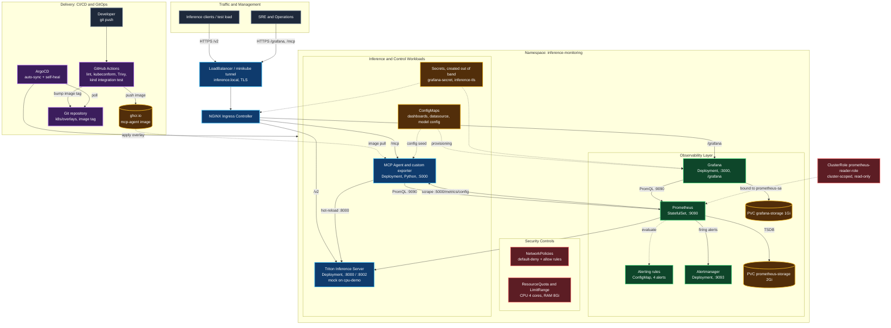

# Autonomic Inference Cluster and Observability Stack on Kubernetes

[](https://kubernetes.io/)
[](https://prometheus.io/)
[](https://grafana.com/)
[](https://argoproj.github.io/cd/)
[](https://trivy.dev/)
[](https://developer.nvidia.com/triton-inference-server)
[](https://www.python.org/)

Infrastructure for serving, monitoring, and dynamically tuning AI inference workloads in Kubernetes with zero-trust security controls and GitOps-driven deployment.

---

## Overview

The Autonomic Inference Cluster provides automated performance management and monitoring for Large Language Model (LLM) serving in Kubernetes.

Key workflow during high traffic load:
1. **Metrics Collection:** Prometheus scrapes inference metrics (latency, queue duration, VRAM, request count) at 1-second intervals.
2. **Alert Evaluation:** Alerting rules (ConfigMap in the standalone profile, `PrometheusRule` in the operator profile) track thresholds for latency and queue buildup; firing alerts are delivered to Alertmanager.
3. **Control Loop (MCP Agent):** A Python-based agent queries Prometheus via PromQL and determines optimal runtime parameters.
4. **Dynamic Reconfiguration:** The agent updates model configuration (`max_num_seqs`, `gpu_memory_utilization`) and triggers a zero-downtime hot reload.
5. **Continuous Deployment:** GitHub Actions lints and validates every overlay, scans it with Trivy, runs the test procedure on a `kind` cluster, pushes the agent image to `ghcr.io` and bumps the image tag in Git; ArgoCD reconciles the cluster from Git.

---

## Architecture



---

## Key Features

### 1. Kubernetes Workload Design
* **StatefulSet and Deployment Separation:** Prometheus runs as a `StatefulSet` with persistent volume backing (`PersistentVolumeClaim`) for TSDB data persistence. Grafana, Triton, and the MCP Agent run as stateless `Deployments`.
* **Zero-Downtime Hot-Reload:** Uses an `initContainer` pattern to initialize a writable configuration volume seeded from a `ConfigMap`.
* **Automated Provisioning:** Datasources and dashboard configurations are loaded automatically when Grafana starts. Grafana state lives on its own PVC and is served under `/grafana` behind the Ingress.
* **Alertmanager:** Prometheus forwards firing alerts to an Alertmanager Deployment (no external receiver configured by default).
* **Operator profile (optional):** `k8s/addons/operator-stack` provides `ServiceMonitor` and `PrometheusRule` resources plus Helm values for `kube-prometheus-stack`, deployed by a second ArgoCD Application.

### 2. Security Hardening and DevSecOps
* **Pod Security Standards:** Workloads run with `runAsNonRoot: true`, non-zero UIDs (472, 10001, 65534), `allowPrivilegeEscalation: false`, and `capabilities: drop: ["ALL"]`.
* **Network Segmentation:** Enforces `default-deny-all` baseline traffic policies; pod communication is permitted only on explicit service ports.
* **Least Privilege RBAC:** Prometheus uses dedicated `ServiceAccount` and `ClusterRole` resources with read-only access to nodes, pods, and endpoints.
* **Secrets out of Git:** The Grafana admin password and the Ingress TLS certificate are generated by `scripts/bootstrap_secrets.sh`; no credentials are stored in the repository.
* **Pipeline Auditing:** The CI/CD workflow uses `yamllint`, `shellcheck`, `kubeconform` (all rendered overlays), `trivy` (IaC scan fails on CRITICAL, image scan fails on fixable HIGH/CRITICAL) and an end-to-end test on `kind`.

### 3. Dual Runtime Profiles
* **`k8s/overlays/gpu`:** Production profile requesting physical NVIDIA GPU resources (`nvidia.com/gpu: 1`) for Triton + vLLM.
* **`k8s/overlays/cpu-demo`:** Lightweight mock runtime in Python that reproduces Triton APIs and Prometheus metrics for local testing without GPU hardware (< 60 MB RAM).

### 4. GitOps Workflow
* Declarative application configuration managed by ArgoCD (`k8s/gitops/argocd-application.yaml`).
* Continuous reconciliation between repository state and cluster resources (automated sync, prune, self-heal).
* The `gitops-bump` CI job commits the new `mcp-agent` image tag (`ghcr.io/shengan01/mcp-agent`) to the overlays, which is what triggers the rollout. The package must be public (or an image pull secret configured) for the cluster to pull it.
* Secrets must exist before the first sync: run `./scripts/bootstrap_secrets.sh` once against the target cluster.

---

## Quick Start

### Prerequisites
* `kubectl` (v1.28+)
* `minikube` (or any Kubernetes cluster)
* `docker`

### 1. Deployment
Deploy to Minikube with required addons and health checks:
```bash
# Deploy lightweight demonstration profile:
./scripts/deploy_minikube.sh cpu-demo

# Or deploy with physical NVIDIA GPU support:
./scripts/deploy_minikube.sh gpu
```

### 2. Service Access
Grafana, Triton and the MCP Agent are exposed through the NGINX Ingress (TLS, self-signed certificate):
```bash
echo "$(minikube ip) inference.local" | sudo tee -a /etc/hosts
# or, for a LoadBalancer address, run in a separate terminal: minikube tunnel
kubectl -n inference-monitoring get secret grafana-secret -o jsonpath='{.data.admin-password}' | base64 -d
```

| Service | Address | Credentials | Description |
| :--- | :--- | :--- | :--- |
| **Grafana** | `https://inference.local/grafana/` | `admin` / generated password | Pre-configured dashboard |
| **Triton Server** | `https://inference.local/v2/health/ready` | None | Inference and health endpoints |
| **MCP Agent** | `https://inference.local/mcp/health` | None | Reconfiguration API and `/metrics/config` |

Prometheus and Alertmanager have no Ingress route (they are unauthenticated); reach them with port-forwarding:
```bash
./scripts/start_port_forward.sh &   # Prometheus :9090, Alertmanager :9093, plus local Triton/Agent/Grafana ports
```

### 3. Security Verification
Run the automated RBAC, network policy, and container permission check:
```bash
./scripts/verify_security.sh
```

### 4. Load and Reconfiguration Testing
The test procedure runs as a Job inside the cluster (so results are not distorted by `port-forward`), exits non-zero when a check fails, and writes `test-output.log` and `test-report.json`. The same procedure runs in CI on `kind` and uploads the report as a build artifact:
```bash
LOADGEN_IMAGE=mcp-agent:local ./scripts/run_in_cluster_test.sh
```
* **Phase 1: Baseline (20 RPS):** normal load, low server-side latency.
* **Phase 2: Load Spike (400 concurrent requests per second):** in-flight requests exceed `max_num_seqs`, server-side latency rises and `HighInferenceQueueDepth` fires.
* **Phase 3: Reconfiguration:** the MCP Agent applies `max_num_seqs: 512` (hot reload) and server-side latency returns to the baseline.

Latency is computed from Prometheus counters (`nv_inference_request_duration_us / nv_inference_request_success`); client-side latency is reported only as a secondary figure.

---

## Repository Structure

```
├── .github/
│   └── workflows/
│       └── ci-cd.yaml               # CI/CD: lint, kubeconform, Trivy, kind test, ghcr push, GitOps bump
├── docs/
│   ├── DOKUMENTACJA_TECHNICZNA.md   # Technical documentation
│   └── ZADANIE_2_OPIS_I_ARCHITEKTURA.md # Architecture specification report
├── k8s/
│   ├── base/                        # Base Kubernetes resources
│   │   ├── namespace.yaml           # Namespace definition
│   │   ├── rbac.yaml                # RBAC roles and bindings
│   │   ├── resource-quota.yaml      # Resource quotas and limit ranges
│   │   ├── network-policy.yaml      # Network isolation policies
│   │   ├── prometheus/              # Prometheus StatefulSet, PVC, alerts, service
│   │   ├── grafana/                 # Grafana Deployment, PVC, datasources, dashboards
│   │   ├── alertmanager/            # Alertmanager Deployment, config, service
│   │   ├── triton/                  # Triton service and model configuration
│   │   ├── mcp-agent/               # MCP Agent Deployment and service
│   │   └── ingress/                 # Ingress routing rules
│   ├── overlays/
│   │   ├── cpu-demo/                # Lightweight CPU demonstration overlay (registry image)
│   │   ├── gpu/                     # GPU production overlay (registry image)
│   │   └── local-cpu, local-gpu/    # Same, using the locally built mcp-agent image
│   ├── tests/                       # In-cluster load generator Job and test-only NetworkPolicies
│   ├── addons/
│   │   └── operator-stack/          # ServiceMonitors, PrometheusRule, Helm values (kube-prometheus-stack)
│   └── gitops/
│       ├── argocd-application.yaml          # Core stack Application
│       └── argocd-application-operator.yaml # Operator profile Applications
├── scripts/
│   ├── deploy_minikube.sh           # Deployment automation script
│   ├── bootstrap_secrets.sh         # Creates Grafana and TLS secrets (not stored in Git)
│   ├── mock_triton_server.py        # Lightweight mock Triton server
│   ├── test_k8s_simulation.py       # Load testing and verification script (runs in-cluster)
│   ├── run_in_cluster_test.sh       # Runs the test as a Job and extracts the report
│   ├── verify_security.sh           # Security audit script
│   └── start_port_forward.sh        # Port forwarding helper
├── mcp_agent/                       # Agent source code (FastMCP + Prometheus API)
└── grafana/dashboards/              # Grafana dashboard JSON (source of the dashboard ConfigMap)
```

---

## Metrics and Alerting

### Collected Metrics
* `nv_inference_request_duration_us`: Total request latency in microseconds.
* `nv_inference_queue_duration_us`: Time spent waiting in the execution queue.
* `nv_inference_request_success`: Total successful inference operations.
* `nv_gpu_utilization`: GPU compute utilization percentage.
* `nv_gpu_memory_used_bytes` / `nv_gpu_memory_total_bytes`: VRAM allocation.
* `triton_config_max_num_seqs`: Active batch parallelism setting.

### Alert Definitions (`k8s/base/prometheus/alerting-rules.yaml`, mirrored as `PrometheusRule` in the operator profile)
1. **`InferenceServerDown`** (`critical`): Triggered if Triton target is unreachable for > 10s.
2. **`HighInferenceLatency`** (`warning`): Triggered if average latency exceeds 50 ms for > 15s.
3. **`HighInferenceQueueDepth`** (`warning`): Triggered if queue latency exceeds 100 ms for > 15s.
4. **`GPUMemorySaturation`** (`critical`): Triggered if VRAM utilization exceeds 85% for > 30s.

---

## License

This project is licensed under the [MIT License](LICENSE).
