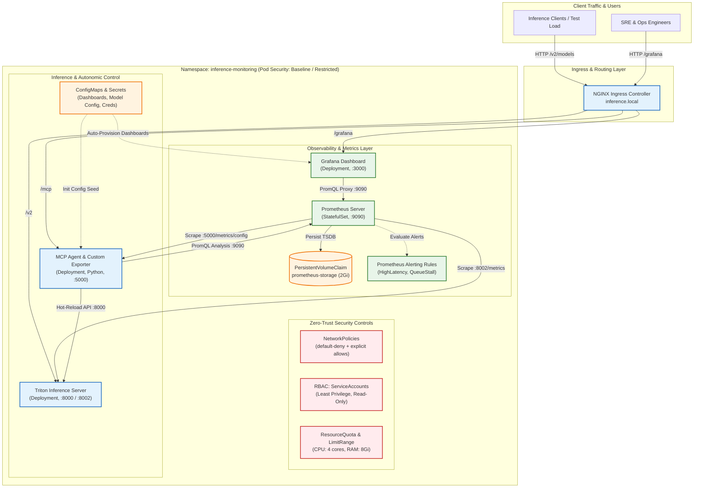

# 🚀 Autonomic Inference Cluster & Observability Stack on Kubernetes

[](https://kubernetes.io/)
[](https://prometheus.io/)
[](https://grafana.com/)
[](https://argoproj.github.io/cd/)
[](https://trivy.dev/)
[](https://developer.nvidia.com/triton-inference-server)
[](https://www.python.org/)

> **Self-Healing AI Infrastructure, Real-time Observability, Zero-Trust Security Hardening, and GitOps Lifecycle Management in Kubernetes.**

---

## 📖 Overview

The **Autonomic Inference Cluster** is an enterprise-grade cloud-native platform designed to serve, monitor, and autonomously optimize Large Language Model (LLM) inference workloads on **Kubernetes**.

When traffic spikes degrade response times:
1. **High-Resolution Observability:** Prometheus scrapes granular inference metrics (`latency`, `queue duration`, `VRAM`, `throughput`) every second.
2. **Alert Evaluation:** Declarative alerting rules (`PrometheusRule`) detect SLA/SLO violations immediately.
3. **Autonomic SRE Controller (MCP Agent):** A Python-based controller queries Prometheus metrics via PromQL, detects saturation, and calculates optimal batching parameters.
4. **Zero-Downtime Hot-Reload:** The agent dynamically adjusts Triton configuration (`max_num_seqs`, `gpu_memory_utilization`) and executes a hot reload without restarting pods or dropping incoming connections.
5. **GitOps & DevSecOps:** The cluster state is reconciled continuously by **ArgoCD**, while **GitHub Actions** enforces YAML linting, `kubeconform` schema validation, and **Trivy** vulnerability scanning.

---

## 🏗️ Architecture



---

## 🛡️ Key Features

### 1. Kubernetes-Native Management
* **StatefulSet vs. Deployment Isolation:** Prometheus runs as a `StatefulSet` with a `PersistentVolumeClaim` (PVC) guaranteeing TSDB data persistence across pod rescheduling, while Grafana, Triton, and the MCP Agent run as stateless `Deployments`.
* **Zero-Downtime Hot-Reload:** Uses an `initContainer` pattern with a writable `emptyDir` seeded from a `ConfigMap` for live parameter tuning.
* **Declarative Provisioning:** Datasources and the comprehensive *Autonomous Inference Cluster* dashboard are auto-provisioned upon Grafana container startup.

### 2. Zero-Trust Security & DevSecOps
* **Pod Security Standards & SecurityContext:** All workloads run strictly as `runAsNonRoot: true` with unique non-privileged UIDs (e.g., 472, 10001, 65534), `allowPrivilegeEscalation: false`, and `capabilities: drop: ["ALL"]`.
* **Microsegmentation (NetworkPolicy):** Enforces a `default-deny-all` baseline; inter-pod traffic is explicitly restricted to required ports.
* **RBAC Least Privilege:** Prometheus operates via dedicated `ServiceAccount` and `ClusterRole` granting read-only access to nodes, pods, and endpoints with zero access to secrets or pod mutation.
* **Continuous Security Scanning:** The GitHub Actions CI/CD pipeline scans IaC manifests with `yamllint`, validates schemas with `kubeconform`, and checks vulnerabilities using `trivy`.

### 3. Dual Runtime Profile (Kustomize Overlays)
* **`k8s/overlays/gpu`:** Production profile targeting physical NVIDIA GPUs (`nvidia.com/gpu: 1`) with Triton + vLLM.
* **`k8s/overlays/cpu-demo`:** Lightweight mock runtime written in pure Python that emulates Triton APIs and exact Prometheus metrics, allowing instant deployment on any Minikube, Kind, or laptop environment (consumes < 60 MB RAM).

### 4. GitOps Continuous Delivery (ArgoCD)
* Declarative `Application` CRD in `k8s/gitops/argocd-application.yaml`.
* **Single Source of Truth:** Git repository defines desired state with automated drift detection, reconciliation, and self-healing.

---

## 🚀 Quick Start (Kubernetes / Minikube)

### Prerequisites
* `kubectl` (v1.28+)
* `minikube` (or any Kubernetes cluster)
* `docker`

### 1. One-Click Automated Deployment
Deploy the full stack onto Minikube with automatic addon enablement and health verification:
```bash
# Deploy lightweight demonstration profile (works on any machine without GPU):
./scripts/deploy_minikube.sh cpu-demo

# Or deploy with physical NVIDIA GPU acceleration:
./scripts/deploy_minikube.sh gpu
```

### 2. Access Web Dashboards and APIs
Expose the cluster services to localhost:
```bash
./scripts/start_port_forward.sh &
```

| Service | Local URL | Default Credentials | Description |
| :--- | :--- | :--- | :--- |
| **Grafana** | [http://localhost:3000](http://localhost:3000) | `admin` / `admin_k8s_secure_2026!` | Pre-configured inference dashboards |
| **Prometheus** | [http://localhost:9090](http://localhost:9090) | *(None)* | Metrics explorer, targets & active alerts |
| **Triton Server** | [http://localhost:8000](http://localhost:8000/v2/health/ready) | *(None)* | Inference & healthcheck endpoints |
| **MCP Agent** | [http://localhost:5000](http://localhost:5000/health) | *(None)* | Autonomic SRE API & `/metrics/config` |

### 3. Run Automated Security Audit
Verify RBAC least privilege, NetworkPolicies, and non-root SecurityContext:
```bash
./scripts/verify_security.sh
```

### 4. Run Load & Self-Healing Simulation
Execute the automated 3-act test procedure:
```bash
python3 scripts/test_k8s_simulation.py
```
* **Act 1: The Calm (20 RPS):** Baseline traffic, latency < 20 ms.
* **Act 2: The Storm (150 RPS):** Traffic spike saturates queue, latency degrades, `HighInferenceLatency` alert triggers.
* **Act 3: The Resolution:** MCP Agent reconfigures Triton (`max_num_seqs: 512`), hot-reload executes, and latency recovers to nominal levels.

---

## 📁 Repository Structure

```
├── .github/
│   └── workflows/
│       └── ci-cd.yaml               # DevSecOps pipeline (Linter + Kubeconform + Trivy)
├── docs/
│   ├── DOKUMENTACJA_TECHNICZNA.md   # Comprehensive technical documentation
│   └── ZADANIE_2_OPIS_I_ARCHITEKTURA.md # Task 2 functional & architectural report
├── k8s/
│   ├── base/                        # Kustomize base manifests
│   │   ├── namespace.yaml           # Namespace with Pod Security Standards
│   │   ├── rbac.yaml                # Least privilege RBAC roles & bindings
│   │   ├── resource-quota.yaml      # Cluster ResourceQuota and LimitRange
│   │   ├── network-policy.yaml      # Zero-trust inter-pod isolation
│   │   ├── prometheus/              # StatefulSet, PVC, alerting rules, service
│   │   ├── grafana/                 # Deployment, datasources, dashboards, secret
│   │   ├── triton/                  # Services & model configmaps
│   │   ├── mcp-agent/               # Deployment with initContainer & config volume
│   │   └── ingress/                 # Ingress NGINX routing
│   ├── overlays/
│   │   ├── cpu-demo/                # Lightweight demo profile (no GPU required)
│   │   └── gpu/                     # NVIDIA GPU-accelerated production profile
│   └── gitops/
│       └── argocd-application.yaml  # ArgoCD GitOps Application CRD
├── scripts/
│   ├── deploy_minikube.sh           # Automated 1-click Minikube cluster deployment
│   ├── mock_triton_server.py        # Lightweight pure-Python mock Triton engine
│   ├── test_k8s_simulation.py       # End-to-end load testing & SRE demo script
│   ├── verify_security.sh           # Kubernetes security audit verification
│   └── start_port_forward.sh        # Background port-forwarding helper
├── mcp_agent/                       # Autonomic SRE Agent (FastMCP + Prometheus API)
├── llm_agent/                       # Autonomous decision maker & Q-learning module
├── grafana/                         # Grafana provisioning & dashboard JSON definitions
├── prometheus/                      # Standalone Prometheus scrape configuration
├── triton/                          # Triton Server Dockerfile (vLLM backend)
└── docker-compose.yml               # Local container stack for non-K8s development
```

---

## 📊 Live Metrics & Alerting

### Monitored Metrics
* `nv_inference_request_duration_us`: End-to-end request latency in microseconds.
* `nv_inference_queue_duration_us`: Time requests spend waiting in model queues.
* `nv_inference_request_success`: Cumulative count of successful inferences.
* `nv_gpu_utilization`: Instantaneous GPU compute core utilization percentage.
* `nv_gpu_memory_used_bytes` / `nv_gpu_memory_total_bytes`: VRAM saturation.
* `triton_config_max_num_seqs`: Active parallel sequence batching limit.

### Declarative Alert Rules (`PrometheusRule`)
1. **`InferenceServerDown`** (`critical`): Fired if Triton fails health checks for > 10s.
2. **`HighInferenceLatency`** (`warning`): Fired if average latency exceeds 50 ms for 15s.
3. **`HighInferenceQueueDepth`** (`warning`): Fired if queue latency exceeds 100 ms.
4. **`GPUMemorySaturation`** (`critical`): Fired if VRAM consumption exceeds 85%.

---

## 📄 License & Academic Attribution

This project was developed for the **CI/CD Security / Advanced Cloud & Kubernetes** curriculum.  
Licensed under the [MIT License](LICENSE).
