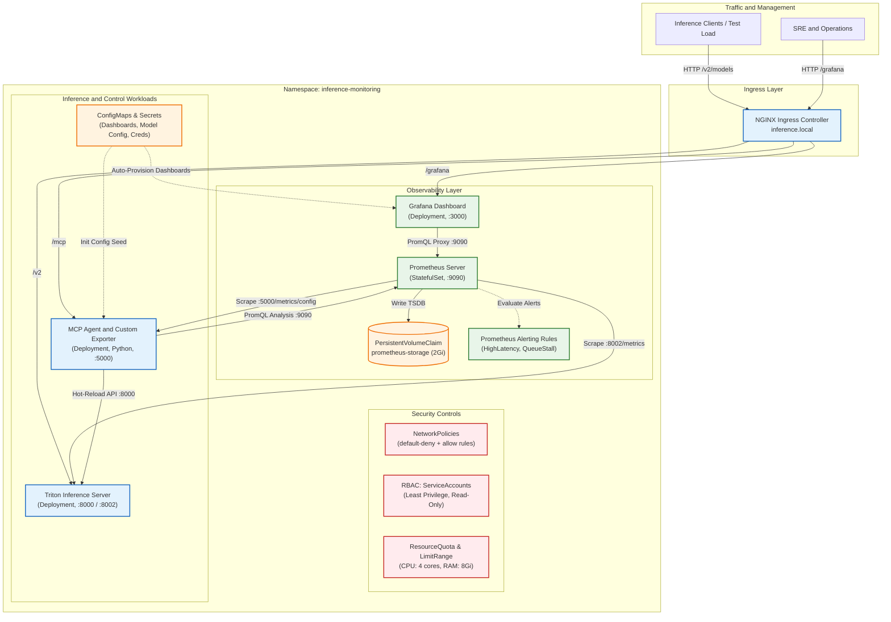

# Autonomic Inference Cluster and Observability Stack on Kubernetes

[](https://kubernetes.io/)
[](https://prometheus.io/)
[](https://grafana.com/)
[](https://argoproj.github.io/cd/)
[](https://trivy.dev/)
[](https://developer.nvidia.com/triton-inference-server)
[](https://www.python.org/)

Infrastructure for serving, monitoring, and dynamically tuning AI inference workloads in Kubernetes with zero-trust security controls and GitOps-driven deployment.

---

## Overview

The Autonomic Inference Cluster provides automated performance management and monitoring for Large Language Model (LLM) serving in Kubernetes.

Key workflow during high traffic load:
1. **Metrics Collection:** Prometheus scrapes inference metrics (latency, queue duration, VRAM, request count) at 1-second intervals.
2. **Alert Evaluation:** Declarative alerting rules (`PrometheusRule`) track thresholds for latency and queue buildup.
3. **Control Loop (MCP Agent):** A Python-based agent queries Prometheus via PromQL and determines optimal runtime parameters.
4. **Dynamic Reconfiguration:** The agent updates model configuration (`max_num_seqs`, `gpu_memory_utilization`) and triggers a zero-downtime hot reload.
5. **Continuous Deployment:** Cluster configuration is synchronized via ArgoCD, with linting, schema validation (`kubeconform`), and vulnerability scanning (`trivy`) run in GitHub Actions.

---

## Architecture



---

## Key Features

### 1. Kubernetes Workload Design
* **StatefulSet and Deployment Separation:** Prometheus runs as a `StatefulSet` with persistent volume backing (`PersistentVolumeClaim`) for TSDB data persistence. Grafana, Triton, and the MCP Agent run as stateless `Deployments`.
* **Zero-Downtime Hot-Reload:** Uses an `initContainer` pattern to initialize a writable configuration volume seeded from a `ConfigMap`.
* **Automated Provisioning:** Datasources and dashboard configurations are loaded automatically when Grafana starts.

### 2. Security Hardening and DevSecOps
* **Pod Security Standards:** Workloads run with `runAsNonRoot: true`, non-zero UIDs (472, 10001, 65534), `allowPrivilegeEscalation: false`, and `capabilities: drop: ["ALL"]`.
* **Network Segmentation:** Enforces `default-deny-all` baseline traffic policies; pod communication is permitted only on explicit service ports.
* **Least Privilege RBAC:** Prometheus uses dedicated `ServiceAccount` and `ClusterRole` resources with read-only access to nodes, pods, and endpoints.
* **Pipeline Auditing:** The CI/CD workflow uses `yamllint` for syntax, `kubeconform` for Kubernetes schema validation, and `trivy` for vulnerability scanning.

### 3. Dual Runtime Profiles
* **`k8s/overlays/gpu`:** Production profile requesting physical NVIDIA GPU resources (`nvidia.com/gpu: 1`) for Triton + vLLM.
* **`k8s/overlays/cpu-demo`:** Lightweight mock runtime in Python that reproduces Triton APIs and Prometheus metrics for local testing without GPU hardware (< 60 MB RAM).

### 4. GitOps Workflow
* Declarative application configuration managed by ArgoCD (`k8s/gitops/argocd-application.yaml`).
* Continuous reconciliation between repository state and cluster resources.

---

## Quick Start

### Prerequisites
* `kubectl` (v1.28+)
* `minikube` (or any Kubernetes cluster)
* `docker`

### 1. Deployment
Deploy to Minikube with required addons and health checks:
```bash
# Deploy lightweight demonstration profile:
./scripts/deploy_minikube.sh cpu-demo

# Or deploy with physical NVIDIA GPU support:
./scripts/deploy_minikube.sh gpu
```

### 2. Service Access
Expose cluster services to the host:
```bash
./scripts/start_port_forward.sh &
```

| Service | Local Address | Credentials | Description |
| :--- | :--- | :--- | :--- |
| **Grafana** | [http://localhost:3000](http://localhost:3000) | `admin` / `admin_k8s_secure_2026!` | Pre-configured dashboard |
| **Prometheus** | [http://localhost:9090](http://localhost:9090) | None | Metrics, targets, and active alerts |
| **Triton Server** | [http://localhost:8000](http://localhost:8000/v2/health/ready) | None | Inference and health endpoints |
| **MCP Agent** | [http://localhost:5000](http://localhost:5000/health) | None | Reconfiguration API and `/metrics/config` |

### 3. Security Verification
Run the automated RBAC, network policy, and container permission check:
```bash
./scripts/verify_security.sh
```

### 4. Load and Reconfiguration Testing
Execute the test procedure:
```bash
python3 scripts/test_k8s_simulation.py
```
* **Phase 1: Baseline (20 RPS):** Normal load, low latency.
* **Phase 2: Load Spike (150 RPS):** Latency degrades, triggering Prometheus warning alerts.
* **Phase 3: Reconfiguration:** MCP Agent applies optimized batch settings (`max_num_seqs: 512`), restoring response latency.

---

## Repository Structure

```
├── .github/
│   └── workflows/
│       └── ci-cd.yaml               # CI/CD pipeline (Yamllint, Kubeconform, Trivy)
├── docs/
│   ├── DOKUMENTACJA_TECHNICZNA.md   # Technical documentation
│   └── ZADANIE_2_OPIS_I_ARCHITEKTURA.md # Architecture specification report
├── k8s/
│   ├── base/                        # Base Kubernetes resources
│   │   ├── namespace.yaml           # Namespace definition
│   │   ├── rbac.yaml                # RBAC roles and bindings
│   │   ├── resource-quota.yaml      # Resource quotas and limit ranges
│   │   ├── network-policy.yaml      # Network isolation policies
│   │   ├── prometheus/              # Prometheus StatefulSet, PVC, alerts, service
│   │   ├── grafana/                 # Grafana Deployment, datasources, dashboards
│   │   ├── triton/                  # Triton service and model configuration
│   │   ├── mcp-agent/               # MCP Agent Deployment and service
│   │   └── ingress/                 # Ingress routing rules
│   ├── overlays/
│   │   ├── cpu-demo/                # Lightweight CPU demonstration overlay
│   │   └── gpu/                     # GPU production overlay
│   └── gitops/
│       └── argocd-application.yaml  # ArgoCD Application resource
├── scripts/
│   ├── deploy_minikube.sh           # Deployment automation script
│   ├── mock_triton_server.py        # Lightweight mock Triton server
│   ├── test_k8s_simulation.py       # Load testing and verification script
│   ├── verify_security.sh           # Security audit script
│   └── start_port_forward.sh        # Port forwarding helper
├── mcp_agent/                       # Agent source code (FastMCP + Prometheus API)
├── llm_agent/                       # LLM decision loop and RL module
├── grafana/                         # Provisioning templates and dashboard JSON
├── prometheus/                      # Standalone Prometheus configuration
├── triton/                          # Triton Server Dockerfile
└── docker-compose.yml               # Compose file for standalone local testing
```

---

## Metrics and Alerting

### Collected Metrics
* `nv_inference_request_duration_us`: Total request latency in microseconds.
* `nv_inference_queue_duration_us`: Time spent waiting in the execution queue.
* `nv_inference_request_success`: Total successful inference operations.
* `nv_gpu_utilization`: GPU compute utilization percentage.
* `nv_gpu_memory_used_bytes` / `nv_gpu_memory_total_bytes`: VRAM allocation.
* `triton_config_max_num_seqs`: Active batch parallelism setting.

### Alert Definitions (`PrometheusRule`)
1. **`InferenceServerDown`** (`critical`): Triggered if Triton target is unreachable for > 10s.
2. **`HighInferenceLatency`** (`warning`): Triggered if average latency exceeds 50 ms for > 15s.
3. **`HighInferenceQueueDepth`** (`warning`): Triggered if queue latency exceeds 100 ms for > 15s.
4. **`GPUMemorySaturation`** (`critical`): Triggered if VRAM utilization exceeds 85% for > 30s.

---

## License

This project is licensed under the [MIT License](LICENSE).
