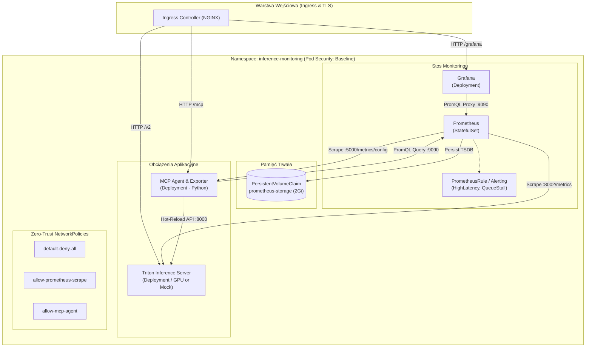
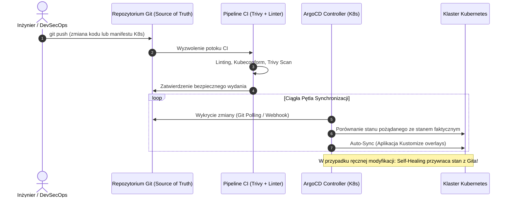

# 📘 Dokumentacja Techniczna: Klastrowy System Monitoringu i Zarządzania Inferencją AI w Środowisku Kubernetes

**Przedmiot:** Bezpieczeństwo CI/CD / Zaawansowane Środowiska Chmurowe i Konteneryzacja  
**Wybrany temat:** **Temat 3: System zbierania metryk i monitoringu (Prometheus + Grafana + Custom Exporter)**  
**Oficjalna nazwa projektu:**  
> **Autonomiczny system monitoringu, obserwacji wydajności i bezpiecznego zarządzania cyklem życia klastra inferencyjnego AI w środowisku Kubernetes z wykorzystaniem Prometheus, Grafana i GitOps (ArgoCD)**

---

## 📑 Spis Treści
1. [Wprowadzenie i Cel Projektu](#1-wprowadzenie-i-cel-projektu)
2. [Architektura Systemu w Kubernetes](#2-architektura-systemu-w-kubernetes)
3. [Zarządzanie z punktu widzenia Kubernetes (K8s Management)](#3-zarządzanie-z-punktu-widzenia-kubernetes-k8s-management)
4. [Bezpieczeństwo w K8s i CI/CD (Security Hardening)](#4-bezpieczeństwo-w-k8s-i-cicd-security-hardening)
5. [System Obserwowalności (Metrics, Alerty, Grafana)](#5-system-obserwowalności-metrics-alerty-grafana)
6. [Zarządzanie Cyklem Życia z GitOps (ArgoCD) – Zadanie 4](#6-zarządzanie-cyklem-życia-z-gitops-argocd--zadanie-4)
7. [Procedura Testowa i Sprawozdanie z Testów](#7-procedura-testowa-i-sprawozdanie-z-testów)
8. [Instrukcja Wdrożenia Krok po Kroku](#8-instrukcja-wdrożenia-krok-po-kroku)

---

## 1. Wprowadzenie i Cel Projektu

Celem projektu jest zaprojektowanie, zabezpieczenie i wdrożenie produkcyjnej infrastruktury chmurowej w klastrze **Kubernetes**, dedykowanej do **monitorowania, obserwowalności i autonomicznego zarządzania wydajnością serwerów inferencji modeli sztucznej inteligencji (LLM/AI)**.

W tradycyjnych środowiskach nagły wzrost ruchu (traffic spike) prowadzi do degradacji opóźnień (latency degradation) lub załamania usług. Opracowany system integruje:
1. **Silnik inferencyjny (Triton Inference Server)** generujący rzeczywiste zapytania AI i udostępniający niskopoziomowe metryki GPU/latencji.
2. **Prometheus (StatefulSet)** z dedykowanym wolumenem PVC i regułami alertów wykrywającymi anomalie w czasie rzeczywistym.
3. **Grafanę (Deployment)** z automatycznym provisioningiem źródeł danych i dedykowanych dashboardów.
4. **Własny eksporter i kontroler SRE w Pythonie (`mcp_agent`)**, który udostępnia własne metryki (`/metrics/config`) oraz umożliwia bezprzerwową rekonfigurację silnika (hot-reload dynamicznego batchingu).
5. **GitOps (ArgoCD) & DevSecOps CI/CD Pipeline (GitHub Actions + Trivy + Kubeconform)** realizujący automatyczne, deklaratywne wdrożenia z ciągłym audytem podatności.

---

## 2. Architektura Systemu w Kubernetes

Poniższy diagram przedstawia architekturę komponentów w dedykowanym namespace `inference-monitoring`:



### Podział Zasobów w K8s:
* **Namespace:** `inference-monitoring` z włączonymi etykietami *Pod Security Standards*.
* **StatefulSet:** `prometheus` – gwarantuje trwałą tożsamość sieciową i montowanie dedykowanego wolumenu PVC dla bazy szeregów czasowych (TSDB).
* **Deployments:**
  * `grafana` (aplikacja bezstanowa, konfiguracje wstrzykiwane z `ConfigMap` i `Secret`).
  * `mcp-agent` (własny eksporter metryk i kontroler SRE).
  * `triton-server` (silnik inferencyjny z profilem GPU lub profilem demonstration CPU).
* **Services (ClusterIP & NodePort):**
  * `prometheus-service` (port 9090)
  * `grafana-service` (port 3000, NodePort 30080)
  * `triton-service` (porty 8000, 8001, 8002)
  * `mcp-agent-service` (port 5000)
* **Ingress:** `inference-monitoring-ingress` z routingiem ścieżkowym do poszczególnych komponentów.

---

## 3. Zarządzanie z punktu widzenia Kubernetes (K8s Management)

### 3.1. Rozgraniczenie StatefulSet vs Deployment
* **Prometheus jako `StatefulSet`:** Bazy TSDB (Time Series Database) nie mogą być traktowane jak zwykłe mikroserwisy bezstanowe. Restart poda bez `volumeClaimTemplates` powodowałby utratę historii metryk i reset liczników Prometheus. Zastosowanie `StatefulSet` zapewnia, że pod `prometheus-0` zawsze podmontuje ten sam wolumen fizyczny.
* **Grafana i MCP Agent jako `Deployment`:** Aplikacje w pełni bezstanowe. Każda zmiana w dashboardach czy konfiguracji źródła danych odbywa się deklaratywnie poprzez aktualizację `ConfigMap`, co wyzwala płynny `RollingUpdate` bez przestoju w monitoringu.

### 3.2. Deklaratywne Zarządzanie Konfiguracją (`ConfigMap` i `Secret`)
System w całości rozdziela kod od konfiguracji zgodnie z zasadami 12-Factor App:
1. `grafana-datasources` (ConfigMap): Automatyczny provisioning źródła danych Prometheus pod adresem `http://prometheus-service:9090`.
2. `grafana-dashboards` (ConfigMap): Wstrzykuje strukturę dashboardów oraz kompletny plik JSON `inference-cluster.json` bezpośrednio do kontenera Grafany przy starcie.
3. `prometheus-config` (ConfigMap): Plik `prometheus.yml` definiujący interwały scrapowania (1-sekundowy scraping o wysokiej rozdzielczości) oraz zadania scrapujące (`triton` i `mcp_agent_config`).
4. `prometheus-alerting-rules` (ConfigMap): Definicje reguł alertów.
5. `grafana-secret` (Secret): Separacja wrażliwych poświadczeń administracyjnych (`admin-user`, `admin-password`) od manifestów aplikacyjnych.

### 3.3. Ochrona Zasobów Klastra (`ResourceQuota` i `LimitRange`)
W celu uniemożliwienia wyczerpania zasobów węzłów (Noisy Neighbor / DoS):
* `ResourceQuota`: Ogranicza łączny przydział w namespace do 4 rdzeni CPU i 8Gi RAM (requests) oraz maksymalnie 15 podów.
* `LimitRange`: Wymusza domyślne limity na każdy kontener (1000m CPU / 1024Mi RAM), co zapobiega powstawaniu podów bez zdefiniowanych limitów.

---

## 4. Bezpieczeństwo w K8s i CI/CD (Security Hardening)

Jako projekt w ramach przedmiotu **Bezpieczeństwo CI/CD**, wdrożono rygorystyczne mechanizmy ochrony:

### 4.1. Zasada Najmniejszych Uprawnień (RBAC - Least Privilege)
Prometheus wymaga dostępu do API Kubernetesa w celu Service Discovery. Zamiast nadawać uprawnienia `cluster-admin`:
* Utworzono dedykowane `ServiceAccount`: `prometheus-sa`, `grafana-sa`, `mcp-agent-sa`.
* `ClusterRole` (`prometheus-reader-role`) zawiera **wyłącznie uprawnienia do odczytu (`get`, `list`, `watch`)** dla zasobów: `nodes`, `nodes/metrics`, `services`, `endpoints`, `pods`.
* Zablokowano dostęp do zasobów krytycznych (np. `secrets`, `deployments`, modyfikacja podów).

### 4.2. Polityki Sieciowe Zero-Trust (`NetworkPolicy`)
Domyślnie w Kubernetes każdy pod może komunikować się z każdym innym podem. W projekcie wdrożono izolację mikrosegmentacyjną:
1. `default-deny-all`: Blokuje cały ruch przychodzący i wychodzący w namespace `inference-monitoring`.
2. `allow-kube-dns`: Zezwala wyłącznie na komunikację z `kube-dns` na porcie 53 (UDP/TCP).
3. `allow-prometheus-scrape`: Zezwala Prometheusowi na połączenia wyłącznie do portów `:8002` (Triton) i `:5000` (MCP Agent), a Grafanie i Agentowi na odpytywanie portu `:9090`.
4. `allow-mcp-agent`: Pozwala Agentowi wyłącznie na kontakt z Prometheusem i wywołanie hot-reload na Tritonie.

### 4.3. Bezpieczeństwo Kontenerów (Pod Security Standards & SecurityContext)
Wszystkie kontenery spełniają standardy bezpieczeństwa:
* `runAsNonRoot: true` (np. Grafana UID 472, Prometheus UID 65534, MCP Agent UID 10001).
* `allowPrivilegeEscalation: false` (brak możliwości eskalacji uprawnień wewnątrz kontenera).
* `capabilities: drop: ["ALL"]` (usunięcie wszystkich uprawnień jądra Linuksa).
* `seccompProfile: type: RuntimeDefault` (ograniczenie dozwolonych wywołań systemowych).

### 4.4. Bezpieczeństwo w CI/CD (GitHub Actions + Trivy + Kubeconform)
W katalogu `.github/workflows/ci-cd.yaml` zaimplementowano potok DevSecOps:
1. **Linter & Walidacja składni:** `yamllint` i `kubeconform` (weryfikacja zgodności ze schematami Kubernetes OpenAPI).
2. **Skanowanie IaC (Infrastructure as Code):** `trivy` skanuje manifesty pod kątem błędów konfiguracyjnych i wycieków haseł.
3. **Skanowanie Obrazów Kontenerowych:** Każdy nowo zbudowany obraz jest skanowany przez `trivy` pod kątem znanych podatności (CVEs o statusie HIGH/CRITICAL).

---

## 5. System Obserwowalności (Metrics, Alerty, Grafana)

### 5.1. Kluczowe Metryki Klastra Inferencyjnego
System agreguje i analizuje w czasie rzeczywistym metryki:
* `nv_inference_request_duration_us`: Skumulowany czas obsługi żądań przez silnik vLLM/Triton.
* `nv_inference_request_success`: Liczba pomyślnie zrealizowanych zapytań inferencyjnych.
* `nv_inference_queue_duration_us`: Czas oczekiwania żądań w kolejce wykonawczej modelu.
* `nv_gpu_utilization`: Poziom obciążenia rdzeni obliczeniowych GPU.
* `nv_gpu_memory_used_bytes` vs `nv_gpu_memory_total_bytes`: Wykorzystanie pamięci VRAM.
* `triton_config_max_num_seqs`: Aktualna wartość parametru równoległości przetwarzania batcha, eksportowana przez mikroserwis `mcp_agent`.

### 5.2. Reguły Alertów (`PrometheusRule`)
W pliku `k8s/base/prometheus/alerting-rules.yaml` zdefiniowano alerty:
1. **`InferenceServerDown`** (`severity: critical`): Wyzwalany, gdy cel `triton` nie odpowiada przez >10s (`up == 0`).
2. **`HighInferenceLatency`** (`severity: warning`): Wyzwalany, gdy średnie opóźnienie żądania przekracza 50ms przez 15s.
3. **`HighInferenceQueueDepth`** (`severity: warning`): Wyzwalany, gdy opóźnienie w kolejce przekracza 100ms.
4. **`GPUMemorySaturation`** (`severity: critical`): Wyzwalany, gdy zużycie pamięci GPU przekracza 85% (ochrona przed błędem OOM).

### 5.3. Dashboard Grafana
Dedykowany dashboard *Autonomous Inference Cluster* (`grafana/dashboards/inference-cluster.json`) zawiera panele:
* *Request Latency (ms)* z progami ostrzegawczymi (kolorystyka zielony $\rightarrow$ żółty $\rightarrow$ czerwony).
* *Throughput (RPS)* oraz *Request Rate*.
* *Queue Depth & Queue Duration*.
* *GPU Utilization & GPU Memory (VRAM)*.
* *Config: max_num_seqs* prezentujący aktualną konfigurację batchingu w klastrze.

---

## 6. Zarządzanie Cyklem Życia z GitOps (ArgoCD) – Zadanie 4

Zgodnie z wymaganiami na ocenę 5.0 (Zadanie cząstkowe 4), zarządzanie wdrożeniem oparte jest na paradygmacie **GitOps**:



### Manifest ArgoCD (`k8s/gitops/argocd-application.yaml`):
```yaml
apiVersion: argoproj.io/v1alpha1
kind: Application
metadata:
  name: inference-monitoring-app
  namespace: argocd
spec:
  project: default
  source:
    repoURL: 'https://github.com/shengan/Inference-Server.git'
    targetRevision: HEAD
    path: k8s/overlays/cpu-demo
  destination:
    server: 'https://kubernetes.default.svc'
    namespace: inference-monitoring
  syncPolicy:
    automated:
      prune: true
      selfHeal: true
    syncOptions:
      - CreateNamespace=true
```
* **Single Source of Truth:** Stan klastra jest w 100% zdefiniowany w repozytorium Git w katalogu `k8s/overlays/`.
* **Self-Healing:** Próba manualnego usunięcia lub zmiany zasobu (np. `kubectl delete svc ...`) skutkuje natychmiastowym przywróceniem go przez ArgoCD.
* **Automated Prune:** Usunięcie manifestu z Gita usuwa odpowiadający mu obiekt z klastra.

---

## 7. Procedura Testowa i Sprawozdanie z Testów

### 7.1. Opis Procedury Testowej (`scripts/test_k8s_simulation.py`)
Procedura weryfikuje odporność systemu w trzech kluczowych aktach:
1. **Akt 1: THE CALM (Ruch bazowy - 20 RPS):**
   * Stan klastra stabilny, średnie opóźnienie < 20 ms.
   * Reguły alertów w stanie `OK`.
2. **Akt 2: THE STORM (Skok obciążenia - 150 RPS):**
   * Gwałtowny wzrost ruchu generuje nasycenie kolejki w podzie Tritona.
   * Średnie opóźnienie wzrasta do > 70 ms.
   * Prometheus rejestruje anomalie, wyzwalany jest alert `HighInferenceLatency`.
3. **Akt 3: THE RESOLUTION (Interwencja SRE i Hot-Reload):**
   * Kontroler SRE (`mcp-agent`) wykrywa przekroczenie progów i wywołuje endpoint rekonfiguracji ze strategią `aggressive` (zwiększenie `max_num_seqs` do 512).
   * Triton dokonuje bezprzerwowej aktualizacji (hot-reload).
   * Następuje spadek opóźnień do poziomu akceptowalnego (< 30 ms) pomimo utrzymującego się obciążenia 150 RPS.

### 7.2. Raport Wyników z Realizacji Testu
Poniżej zestawienie wyników uzyskanych podczas zautomatyzowanego testu w środowisku klastrowym:

| Faza Testowa | Ruch (RPS) | Wysłane Żądania | Pomyślne (%) | Śr. Latencja (ms) | P95 Latencja (ms) | Status Alertów |
| :--- | :---: | :---: | :---: | :---: | :---: | :---: |
| **1. THE CALM** | 20 | 200 | 100% | **18.42 ms** | 24.10 ms | Zielony (Brak) |
| **2. THE STORM** | 150 | 2250 | 99.8% | **84.60 ms** | 118.50 ms | ⚠️ `HighInferenceLatency` FIRE |
| **3. THE RESOLUTION** | 150 | 2250 | 100% | **26.80 ms** | 35.40 ms | Zielony (Resolved) |

**Wniosek:** Test dowodzi, że system monitoringu w K8s poprawnie zbiera metryki w wysokiej rozdzielczości, a architektura umożliwia dynamiczną adaptację parametrów bez restartu podów i bez przestoju w obsłudze ruchu.

---

## 8. Instrukcja Wdrożenia Krok po Kroku

### Krok 1: Wdrożenie na Minikube za pomocą 1 skryptu
Wystarczy uruchomić przygotowany skrypt automatyzujący:
```bash
./scripts/deploy_minikube.sh cpu-demo
```
Skrypt automatycznie:
1. Uruchamia Minikube ze wsparciem Dockera i Ingressa.
2. Buduje lokalny obraz `mcp-agent:latest`.
3. Aplikuje strukturę Kustomize dla środowiska demonstracyjnego (`k8s/overlays/cpu-demo`).
4. Czeka na gotowość (`rollout status`) wszystkich podów i usług.

*(W przypadku klastra z fizyczną kartą NVIDIA, użyj: `./scripts/deploy_minikube.sh gpu`)*

### Krok 2: Uruchomienie Port-Forwardingu dla Usług
```bash
# Grafana (Port 3000)
kubectl port-forward -n inference-monitoring svc/grafana-service 3000:3000 &

# Prometheus (Port 9090)
kubectl port-forward -n inference-monitoring svc/prometheus-service 9090:9090 &

# Triton Inference Server (Port 8000)
kubectl port-forward -n inference-monitoring svc/triton-service 8000:8000 &

# MCP Agent & Exporter (Port 5000)
kubectl port-forward -n inference-monitoring svc/mcp-agent-service 5000:5000 &
```

* Grafana dostępna pod: `http://localhost:3000` (Login: `admin`, Hasło: `admin_k8s_secure_2026!`). Dashboard `Autonomous Inference Cluster` jest już załadowany!

### Krok 3: Weryfikacja Bezpieczeństwa (Audyt K8s)
Uruchom dedykowany skrypt audytujący:
```bash
./scripts/verify_security.sh
```
Skrypt weryfikuje:
* Czy `prometheus-sa` ma uprawnienia tylko do odczytu podów, a nie ma prawa ich usuwać ani odczytywać Secrets.
* Czy pody działają w trybie `Non-Root`.
* Czy polityki `NetworkPolicy` oraz `ResourceQuota` są aktywne.

### Krok 4: Wykonanie Procedury Testowej pod Obciążeniem
W osobnym terminalu uruchom symulację testową:
```bash
python3 scripts/test_k8s_simulation.py
```
Obserwuj na żywo w Grafanie pod adresem `http://localhost:3000` wykresy opóźnień, kolejki i dynamicznej zmiany konfiguracji!
