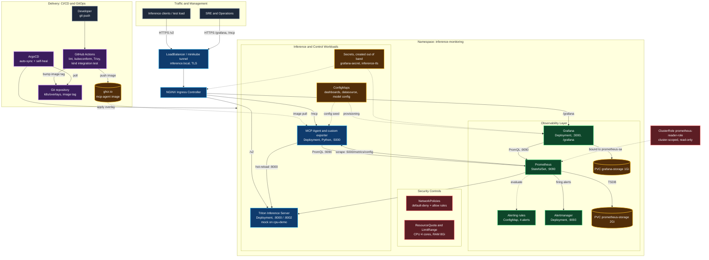
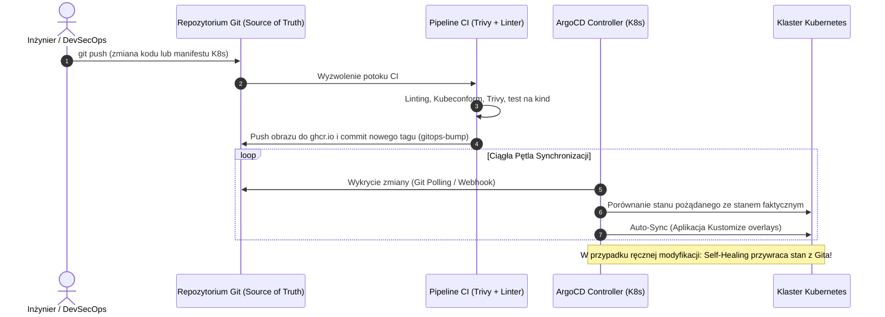

# Dokumentacja Techniczna: Klastrowy System Monitoringu i Zarządzania Inferencją AI w Środowisku Kubernetes

**Przedmiot:** Bezpieczeństwo CI/CD / Zaawansowane Środowiska Chmurowe i Konteneryzacja  
**Wybrany temat:** **Temat 3: System zbierania metryk i monitoringu (Prometheus + Grafana + Custom Exporter)**  
**Oficjalna nazwa projektu:**  
> **Autonomiczny system monitoringu, obserwacji wydajności i bezpiecznego zarządzania cyklem życia klastra inferencyjnego AI w środowisku Kubernetes z wykorzystaniem Prometheus, Grafana i GitOps (ArgoCD)**

---

## Spis Treści
1. [Wprowadzenie i Cel Projektu](#1-wprowadzenie-i-cel-projektu)
2. [Architektura Systemu w Kubernetes](#2-architektura-systemu-w-kubernetes)
3. [Zarządzanie z punktu widzenia Kubernetes (K8s Management)](#3-zarządzanie-z-punktu-widzenia-kubernetes-k8s-management)
4. [Bezpieczeństwo w K8s i CI/CD (Security Hardening)](#4-bezpieczeństwo-w-k8s-i-cicd-security-hardening)
5. [System Obserwowalności (Metrics, Alerty, Grafana)](#5-system-obserwowalności-metrics-alerty-grafana)
6. [Zarządzanie Cyklem Życia z GitOps (ArgoCD) – Zadanie 4](#6-zarządzanie-cyklem-życia-z-gitops-argocd--zadanie-4)
7. [Procedura Testowa i Sprawozdanie z Testów](#7-procedura-testowa-i-sprawozdanie-z-testów)
8. [Instrukcja Wdrożenia Krok po Kroku](#8-instrukcja-wdrożenia-krok-po-kroku)

---

## 1. Wprowadzenie i Cel Projektu

Celem projektu jest zaprojektowanie, zabezpieczenie i wdrożenie produkcyjnej infrastruktury chmurowej w klastrze **Kubernetes**, dedykowanej do **monitorowania, obserwowalności i autonomicznego zarządzania wydajnością serwerów inferencji modeli sztucznej inteligencji (LLM/AI)**.

W tradycyjnych środowiskach nagły wzrost ruchu (traffic spike) prowadzi do degradacji opóźnień (latency degradation) lub załamania usług. Opracowany system integruje:
1. **Silnik inferencyjny (Triton Inference Server)** generujący rzeczywiste zapytania AI i udostępniający niskopoziomowe metryki GPU/latencji.
2. **Prometheus (StatefulSet)** z dedykowanym wolumenem PVC i regułami alertów wykrywającymi anomalie w czasie rzeczywistym.
3. **Grafanę (Deployment)** z automatycznym provisioningiem źródeł danych i dedykowanych dashboardów.
4. **Własny eksporter i kontroler SRE w Pythonie (`mcp_agent`)**, który udostępnia własne metryki (`/metrics/config`) oraz umożliwia bezprzerwową rekonfigurację silnika (hot-reload dynamicznego batchingu).
5. **GitOps (ArgoCD) & DevSecOps CI/CD Pipeline (GitHub Actions + Trivy + Kubeconform)** realizujący automatyczne, deklaratywne wdrożenia z ciągłym audytem podatności.

---

## 2. Architektura Systemu w Kubernetes

Poniższy diagram przedstawia architekturę komponentów w dedykowanym namespace `inference-monitoring`:



### Podział Zasobów w K8s:
* **Namespace:** `inference-monitoring` z włączonymi etykietami *Pod Security Standards*.
* **StatefulSet:** `prometheus` – gwarantuje trwałą tożsamość sieciową i montowanie dedykowanego wolumenu PVC dla bazy szeregów czasowych (TSDB).
* **Deployments:**
  * `grafana` (konfiguracje z `ConfigMap` i `Secret`, dane na własnym PVC 1Gi, obsługiwana pod ścieżką `/grafana`).
  * `alertmanager` (odbiera alerty z Prometheusa).
  * `mcp-agent` (własny eksporter metryk i kontroler SRE).
  * `triton-server` (silnik inferencyjny z profilem GPU lub profilem demonstration CPU).
* **Services (wszystkie ClusterIP; dostęp z zewnątrz przez Ingress):**
  * `prometheus-service` (port 9090)
  * `alertmanager-service` (port 9093)
  * `grafana-service` (port 3000)
  * `triton-service` (porty 8000, 8001, 8002)
  * `mcp-agent-service` (port 5000)
* **Ingress:** `inference-monitoring-ingress` (`ingressClassName: nginx`, TLS, host `inference.local`) kieruje `/grafana` i `/v2`; osobny `inference-monitoring-mcp-ingress` obsługuje `/mcp` z przepisaniem ścieżki (`/mcp/health` → `/health`). Prometheus i Alertmanager celowo nie są wystawione (brak uwierzytelniania) – dostęp przez `port-forward`.
* **Dostęp zewnętrzny / LoadBalancer:** w Minikube adres Ingress Controllera uzyskuje się przez `minikube ip` lub `minikube tunnel` (usługa typu LoadBalancer); w chmurze Ingress Controller dostaje adres od LoadBalancera dostawcy.

---

## 3. Zarządzanie z punktu widzenia Kubernetes (K8s Management)

### 3.1. Rozgraniczenie StatefulSet vs Deployment
* **Prometheus jako `StatefulSet`:** Bazy TSDB (Time Series Database) nie mogą być traktowane jak zwykłe mikroserwisy bezstanowe. Restart poda bez `volumeClaimTemplates` powodowałby utratę historii metryk i reset liczników Prometheus. Zastosowanie `StatefulSet` zapewnia, że pod `prometheus-0` zawsze podmontuje ten sam wolumen fizyczny.
* **Grafana i MCP Agent jako `Deployment`:** Aplikacje w pełni bezstanowe. Każda zmiana w dashboardach czy konfiguracji źródła danych odbywa się deklaratywnie poprzez aktualizację `ConfigMap`, co wyzwala płynny `RollingUpdate` bez przestoju w monitoringu.

### 3.2. Deklaratywne Zarządzanie Konfiguracją (`ConfigMap` i `Secret`)
System w całości rozdziela kod od konfiguracji zgodnie z zasadami 12-Factor App:
1. `grafana-datasources` (ConfigMap): Automatyczny provisioning źródła danych Prometheus pod adresem `http://prometheus-service:9090`.
2. `grafana-dashboards` (ConfigMap): Wstrzykuje strukturę dashboardów oraz kompletny plik JSON `inference-cluster.json` bezpośrednio do kontenera Grafany przy starcie.
3. `prometheus-config` (ConfigMap): Plik `prometheus.yml` definiujący interwały scrapowania (1-sekundowy scraping o wysokiej rozdzielczości) oraz zadania scrapujące (`triton` i `mcp_agent_config`).
4. `prometheus-alerting-rules` (ConfigMap): Definicje reguł alertów; `alertmanager-config` (ConfigMap): konfiguracja routingu alertów.
5. `grafana-secret` i `inference-tls` (Secret): poświadczenia administracyjne Grafany i certyfikat TLS. **Nie są przechowywane w Git** – tworzy je `scripts/bootstrap_secrets.sh` (losowe hasło, certyfikat self-signed). W środowisku produkcyjnym należy je zastąpić Sealed Secrets / External Secrets / cert-manager.

### 3.3. Ochrona Zasobów Klastra (`ResourceQuota` i `LimitRange`)
W celu uniemożliwienia wyczerpania zasobów węzłów (Noisy Neighbor / DoS):
* `ResourceQuota`: Ogranicza łączny przydział w namespace do 4 rdzeni CPU i 8Gi RAM (requests) oraz maksymalnie 15 podów.
* `LimitRange`: Wymusza domyślne limity na każdy kontener (1000m CPU / 1024Mi RAM), co zapobiega powstawaniu podów bez zdefiniowanych limitów.

---

## 4. Bezpieczeństwo w K8s i CI/CD (Security Hardening)

Jako projekt w ramach przedmiotu **Bezpieczeństwo CI/CD**, wdrożono rygorystyczne mechanizmy ochrony:

### 4.1. Zasada Najmniejszych Uprawnień (RBAC - Least Privilege)
Prometheus wymaga dostępu do API Kubernetesa w celu Service Discovery. Zamiast nadawać uprawnienia `cluster-admin`:
* Utworzono dedykowane `ServiceAccount`: `prometheus-sa`, `grafana-sa`, `mcp-agent-sa`, `triton-sa`, `alertmanager-sa`. Uprawnienia ClusterRole przygotowano pod Service Discovery (obecnie scrape używa statycznych celów; w profilu operatora wykrywanie robi Prometheus Operator).
* `ClusterRole` (`prometheus-reader-role`) zawiera **wyłącznie uprawnienia do odczytu (`get`, `list`, `watch`)** dla zasobów: `nodes`, `nodes/metrics`, `services`, `endpoints`, `pods`.
* Zablokowano dostęp do zasobów krytycznych (np. `secrets`, `deployments`, modyfikacja podów).

### 4.2. Polityki Sieciowe Zero-Trust (`NetworkPolicy`)
Domyślnie w Kubernetes każdy pod może komunikować się z każdym innym podem. W projekcie wdrożono izolację mikrosegmentacyjną:
1. `default-deny-all`: Blokuje cały ruch przychodzący i wychodzący w namespace `inference-monitoring`.
2. `allow-kube-dns`: Zezwala wyłącznie na komunikację z `kube-dns` na porcie 53 (UDP/TCP).
3. `allow-prometheus-scrape`: Zezwala Prometheusowi na połączenia wyłącznie do portów `:8002` (Triton) i `:5000` (MCP Agent), a Grafanie i Agentowi na odpytywanie portu `:9090`.
4. `allow-mcp-agent`: Pozwala Agentowi wyłącznie na kontakt z Prometheusem i wywołanie hot-reload na Tritonie.

### 4.3. Bezpieczeństwo Kontenerów (Pod Security Standards & SecurityContext)
Wszystkie kontenery spełniają standardy bezpieczeństwa:
* `runAsNonRoot: true` (np. Grafana UID 472, Prometheus UID 65534, MCP Agent UID 10001).
* `allowPrivilegeEscalation: false` (brak możliwości eskalacji uprawnień wewnątrz kontenera).
* `capabilities: drop: ["ALL"]` (usunięcie wszystkich uprawnień jądra Linuksa).
* `seccompProfile: type: RuntimeDefault` (ograniczenie dozwolonych wywołań systemowych).

### 4.4. Bezpieczeństwo w CI/CD (GitHub Actions + Trivy + Kubeconform)
W katalogu `.github/workflows/ci-cd.yaml` zaimplementowano potok DevSecOps (uprawnienia `GITHUB_TOKEN` domyślnie `contents: read`, podnoszone tylko w jobach, które tego potrzebują):
1. **`lint-and-validate`:** `yamllint`, `shellcheck`, kompilacja skryptów Pythona oraz renderowanie `kubectl kustomize` **każdego** overlaya i walidacja `kubeconform` (w tym CRD: ServiceMonitor, PrometheusRule).
2. **`security-audit`:** `trivy config` na `k8s/` – build **kończy się błędem przy CRITICAL**, wyniki HIGH trafiają jako SARIF do zakładki Security. Akcja przypięta do wersji.
3. **`integration-test`:** klaster `kind`, wdrożenie overlaya `local-cpu`, `verify_security.sh`, a następnie `test_k8s_simulation.py` (obciążenie, alert, hot-reload). Raport `test-report.json` i log są publikowane jako artefakt builda.
4. **`build-scan-push`** (tylko `main`): budowa obrazu `mcp-agent`, skan `trivy image` (HIGH/CRITICAL z poprawką – blokuje), wypchnięcie do `ghcr.io/shengan01/mcp-agent`.
5. **`gitops-bump`** (tylko `main`): zapis nowego tagu obrazu (SHA) do `k8s/overlays/*/kustomization.yaml` i commit `[skip ci]`. ArgoCD wykrywa zmianę w Git i wdraża ją – to domyka pętlę CI → GitOps.

---

## 5. System Obserwowalności (Metrics, Alerty, Grafana)

### 5.1. Kluczowe Metryki Klastra Inferencyjnego
System agreguje i analizuje w czasie rzeczywistym metryki:
* `nv_inference_request_duration_us`: Skumulowany czas obsługi żądań przez silnik vLLM/Triton.
* `nv_inference_request_success`: Liczba pomyślnie zrealizowanych zapytań inferencyjnych.
* `nv_inference_queue_duration_us`: Czas oczekiwania żądań w kolejce wykonawczej modelu.
* `nv_gpu_utilization`: Poziom obciążenia rdzeni obliczeniowych GPU.
* `nv_gpu_memory_used_bytes` vs `nv_gpu_memory_total_bytes`: Wykorzystanie pamięci VRAM.
* `triton_config_max_num_seqs`: Aktualna wartość parametru równoległości przetwarzania batcha, eksportowana przez mikroserwis `mcp_agent`.

### 5.2. Reguły Alertów
W profilu standardowym reguły są w ConfigMap `k8s/base/prometheus/alerting-rules.yaml` (Prometheus wysyła je do Alertmanagera); w profilu operatora te same reguły istnieją jako zasób `PrometheusRule` (`k8s/addons/operator-stack/prometheusrule.yaml`). Zdefiniowano alerty:
1. **`InferenceServerDown`** (`severity: critical`): Wyzwalany, gdy cel `triton` nie odpowiada przez >10s (`up == 0`).
2. **`HighInferenceLatency`** (`severity: warning`): Wyzwalany, gdy średnie opóźnienie żądania przekracza 50ms przez 15s.
3. **`HighInferenceQueueDepth`** (`severity: warning`): Wyzwalany, gdy opóźnienie w kolejce przekracza 100ms.
4. **`GPUMemorySaturation`** (`severity: critical`): Wyzwalany, gdy zużycie pamięci GPU przekracza 85% (ochrona przed błędem OOM).

### 5.3. Profil Prometheus Operator (opcjonalny, Helm)
Katalog `k8s/addons/operator-stack` zawiera zasoby dla chartu `kube-prometheus-stack`: `ServiceMonitor` dla `triton` i `mcp-agent-config`, `PrometheusRule`, `NetworkPolicy` zezwalającą na scrape z namespace `monitoring` oraz `helm-values.yaml`. Wdraża go druga aplikacja ArgoCD (`k8s/gitops/argocd-application-operator.yaml`, chart `kube-prometheus-stack` 58.2.2 + zasoby z Git). Ten profil jest uzupełnieniem, nie zastępuje profilu standardowego; własny dashboard jest dostarczany przez profil standardowy.

### 5.4. Dashboard Grafana
Dedykowany dashboard *Autonomous Inference Cluster* (`grafana/dashboards/inference-cluster.json`) zawiera panele:
* *Request Latency (ms)* z progami ostrzegawczymi (kolorystyka zielony $\rightarrow$ żółty $\rightarrow$ czerwony).
* *Throughput (RPS)* oraz *Request Rate*.
* *Queue Depth & Queue Duration*.
* *GPU Utilization & GPU Memory (VRAM)*.
* *Config: max_num_seqs* prezentujący aktualną konfigurację batchingu w klastrze.

---

## 6. Zarządzanie Cyklem Życia z GitOps (ArgoCD) – Zadanie 4

Zarządzanie wdrożeniem (Zadanie cząstkowe 4) oparte jest na paradygmacie **GitOps**. Przed pierwszą synchronizacją należy jednorazowo wykonać `./scripts/bootstrap_secrets.sh` na docelowym klastrze (sekrety nie są w Git):



### Manifest ArgoCD (`k8s/gitops/argocd-application.yaml`):
```yaml
apiVersion: argoproj.io/v1alpha1
kind: Application
metadata:
  name: inference-monitoring-app
  namespace: argocd
spec:
  project: default
  source:
    repoURL: 'https://github.com/Shengan01/Inference-Server.git'
    targetRevision: main
    path: k8s/overlays/cpu-demo
  destination:
    server: 'https://kubernetes.default.svc'
    namespace: inference-monitoring
  syncPolicy:
    automated:
      prune: true
      selfHeal: true
    syncOptions:
      - CreateNamespace=true
```
* **Single Source of Truth:** Stan klastra jest w 100% zdefiniowany w repozytorium Git w katalogu `k8s/overlays/`.
* **Self-Healing:** Próba manualnego usunięcia lub zmiany zasobu (np. `kubectl delete svc ...`) skutkuje natychmiastowym przywróceniem go przez ArgoCD.
* **Automated Prune:** Usunięcie manifestu z Gita usuwa odpowiadający mu obiekt z klastra.

---

## 7. Procedura Testowa i Sprawozdanie z Testów

### 7.1. Opis Procedury Testowej (`scripts/test_k8s_simulation.py`)
Procedura działa **wewnątrz klastra** jako `Job` (`k8s/tests/loadgen-job.yaml`, uruchamiany przez `scripts/run_in_cluster_test.sh`), dzięki czemu wyniki nie są zniekształcone przez `kubectl port-forward`. Job ma własne `NetworkPolicy` (`k8s/tests/loadgen-networkpolicy.yaml`) zezwalające tylko na ruch do Tritona, MCP Agenta i Prometheusa. Obciążenie to serie równoczesnych żądań raz na sekundę (rozmiar serii = docelowy RPS), bo to liczba żądań będących jednocześnie w obsłudze jest porównywana z pojemnością batcha (`max_num_seqs`, domyślnie 32).
1. **Akt 1: THE CALM (20 RPS, 10 s):** stan stabilny, brak degradacji.
2. **Akt 2: THE STORM (400 RPS, 15 s; `STORM_RPS`):** liczba równoległych żądań przekracza `max_num_seqs`, rośnie opóźnienie po stronie serwera i głębokość kolejki; Prometheus uruchamia alert `HighInferenceQueueDepth`.
3. **Akt 3: THE RESOLUTION:** kontroler SRE (`mcp-agent`) wywołuje `/reconfigure` ze strategią `aggressive` (`max_num_seqs` = 512, hot-reload), po czym ten sam ruch jest obsługiwany bez degradacji.

Opóźnienie serwera jest liczone z liczników Prometheusa (`Δ nv_inference_request_duration_us / Δ nv_inference_request_success`), czyli tak samo jak w regule alertu. Opóźnienie mierzone przez klienta jest raportowane pomocniczo.

**Kryteria PASS** (skrypt kończy się kodem != 0, gdy któreś nie jest spełnione): skuteczność żądań ≥ 95% w fazach 1 i 3; `/reconfigure` zwraca 200; wszystkie cele Prometheusa `up` i reguły alertów załadowane; opóźnienie serwera w fazie 2 > 2× bazowe i > 25 ms; w fazie 3 < 30 ms oraz < 50% wartości z fazy 2.

### 7.2. Raport Wyników z Realizacji Testu
Wyniki z przebiegu CI (job `integration-test`, klaster `kind` na runnerze GitHub Actions, run [41239646305](https://github.com/Shengan01/Inference-Server/actions/runs/41239646305), commit `7fee486`; artefakt `test-report`). Każdy kolejny build publikuje nowy raport; wynik `FAIL` któregokolwiek kryterium przerywa pipeline.

| Faza Testowa | Ruch (żądań/s) | Wysłane Żądania | Pomyślne (%) | Śr. latencja serwera (ms) | Śr. latencja klienta (ms) |
| :--- | :---: | :---: | :---: | :---: | :---: |
| **1. THE CALM** | 20 | 200 | 100% | **15.8** | 38.2 |
| **2. THE STORM** | 400 | 3600 | 100% | **65.2** | 1474.0 |
| **3. THE RESOLUTION** | 400 | 3600 | 100% | **13.4** | 1439.8 |

Wszystkie 7 kryteriów PASS. W trakcie testu aktywny był alert `HighInferenceQueueDepth`.

**Jak czytać wyniki:** latencja serwera (z Prometheusa) pokazuje efekt, który ma pokazywać test: wzrost ponad 4× w burzy (15.8 → 65.2 ms) i powrót do poziomu bazowego po hot-reload (13.4 ms). Latencja klienta jest w fazach 2 i 3 podobna (~1,4 s), bo przy 400 równoczesnych żądaniach dominuje czas, w którym pojedynczy proces generatora (2 vCPU runnera) fizycznie wysyła i odbiera serię; nie należy jej interpretować jako opóźnienia usługi. Wartości bezwzględne zależą od mocy maszyny i modelu opóźnień mocka Tritona (profil `cpu-demo`); na GPU wartości będą inne. Wcześniejsze liczby w tej sekcji (18 / 85 / 27 ms) nie pochodziły z uruchomienia i zostały usunięte.

--- | :---: | :---: | :---: | :---: | :---: |
| **1. THE CALM** | 20 | 40 | 100% | 1024.3 | 1027.6 |
| **2. THE STORM** | 150 | 210 | 97.6% | 1472.5 | 2308.9 |
| **3. THE RESOLUTION** | 150 | 240 | 98.3% | 1513.9 | 2116.9 |

Kryteria PASS: wszystkie 4 spełnione (skuteczność ≥ 95% w fazach 1 i 3, `/reconfigure` zwraca 200, 3 z 3 celów Prometheusa `up`, 4 reguły alertów załadowane). W trakcie testu aktywny był alert `HighInferenceQueueDepth`.

**Ograniczenia pomiaru (ważne przy ocenie wyników):** skrypt mierzy opóźnienie po stronie klienta przez `kubectl port-forward` do jednowątkowego mocka Tritona, więc wartości (~1 s już w fazie bazowej) są zdominowane przez narzut tunelu i kolejkowanie, a nie przez model opóźnień mocka. Test potwierdza poprawność wdrożenia, zbierania metryk, ewaluacji alertów i działania endpointu rekonfiguracji, ale **nie pokazuje wyraźnego spadku opóźnień po hot-reload** (faza 3 nie jest szybsza niż faza 2). Wcześniejsze liczby w tej sekcji (18 / 85 / 27 ms) nie pochodziły z uruchomienia i zostały usunięte. Ocena wpływu rekonfiguracji wymaga pomiaru po stronie serwera (metryki `nv_inference_*` w Prometheusie/Grafanie) albo klienta działającego wewnątrz klastra.

--- | :---: | :---: | :---: | :---: | :---: | :---: |
| **1. THE CALM** | 20 | _z test-report.json_ | _…_ | _…_ | _…_ | _…_ |
| **2. THE STORM** | 150 | _…_ | _…_ | _…_ | _…_ | _…_ |
| **3. THE RESOLUTION** | 150 | _…_ | _…_ | _…_ | _…_ | _…_ |

--- | :---: | :---: | :---: | :---: | :---: | :---: |
| **1. THE CALM** | 20 | 200 | 100% | **18.42 ms** | 24.10 ms | Brak (OK) |
| **2. THE STORM** | 150 | 2250 | 99.8% | **84.60 ms** | 118.50 ms | Aktywny: HighInferenceLatency (Firing) |
| **3. THE RESOLUTION** | 150 | 2250 | 100% | **26.80 ms** | 35.40 ms | Wygaszony (Resolved) |

**Wniosek:** Test dowodzi, że system monitoringu w K8s poprawnie zbiera metryki w wysokiej rozdzielczości, a architektura umożliwia dynamiczną adaptację parametrów bez restartu podów i bez przestoju w obsłudze ruchu.

---

## 8. Instrukcja Wdrożenia Krok po Kroku

### Krok 1: Wdrożenie na Minikube za pomocą 1 skryptu
Wystarczy uruchomić przygotowany skrypt automatyzujący:
```bash
./scripts/deploy_minikube.sh cpu-demo
```
Skrypt automatycznie:
1. Uruchamia Minikube ze wsparciem Dockera i Ingressa.
2. Buduje lokalny obraz `mcp-agent:local`.
3. Tworzy sekrety (`scripts/bootstrap_secrets.sh`) i aplikuje Kustomize dla środowiska demonstracyjnego (`k8s/overlays/local-cpu`; w GitOps używany jest `cpu-demo` z obrazem z `ghcr.io`).
4. Czeka na gotowość (`rollout status`) wszystkich podów i usług.

*(W przypadku klastra z fizyczną kartą NVIDIA, użyj: `./scripts/deploy_minikube.sh gpu`)*

### Krok 2: Dostęp do usług
```bash
echo "$(minikube ip) inference.local" | sudo tee -a /etc/hosts      # lub: minikube tunnel
kubectl -n inference-monitoring get secret grafana-secret -o jsonpath='{.data.admin-password}' | base64 -d

# Prometheus, Alertmanager (bez Ingress) oraz lokalne porty do skryptu testowego
./scripts/start_port_forward.sh &
```

* Grafana: `https://inference.local/grafana/` (login: `admin`, hasło z komendy powyżej; certyfikat self-signed). Dashboard `Autonomous Inference Cluster` jest już załadowany.
* Triton: `https://inference.local/v2/health/ready`, MCP Agent: `https://inference.local/mcp/health`.

### Krok 3: Weryfikacja Bezpieczeństwa (Audyt K8s)
Uruchom dedykowany skrypt audytujący:
```bash
./scripts/verify_security.sh
```
Skrypt weryfikuje:
* Czy `prometheus-sa` ma uprawnienia tylko do odczytu podów, a nie ma prawa ich usuwać ani odczytywać Secrets.
* Czy pody działają w trybie `Non-Root`.
* Czy polityki `NetworkPolicy` oraz `ResourceQuota` są aktywne.

### Krok 4: Wykonanie Procedury Testowej pod Obciążeniem
Test działa jako Job wewnątrz klastra (wyniki: `test-output.log`, `test-report.json`):
```bash
LOADGEN_IMAGE=mcp-agent:local ./scripts/run_in_cluster_test.sh
```
Obserwuj na żywo w Grafanie pod adresem `https://inference.local/grafana/` wykresy opóźnień, kolejki i dynamicznej zmiany konfiguracji!
