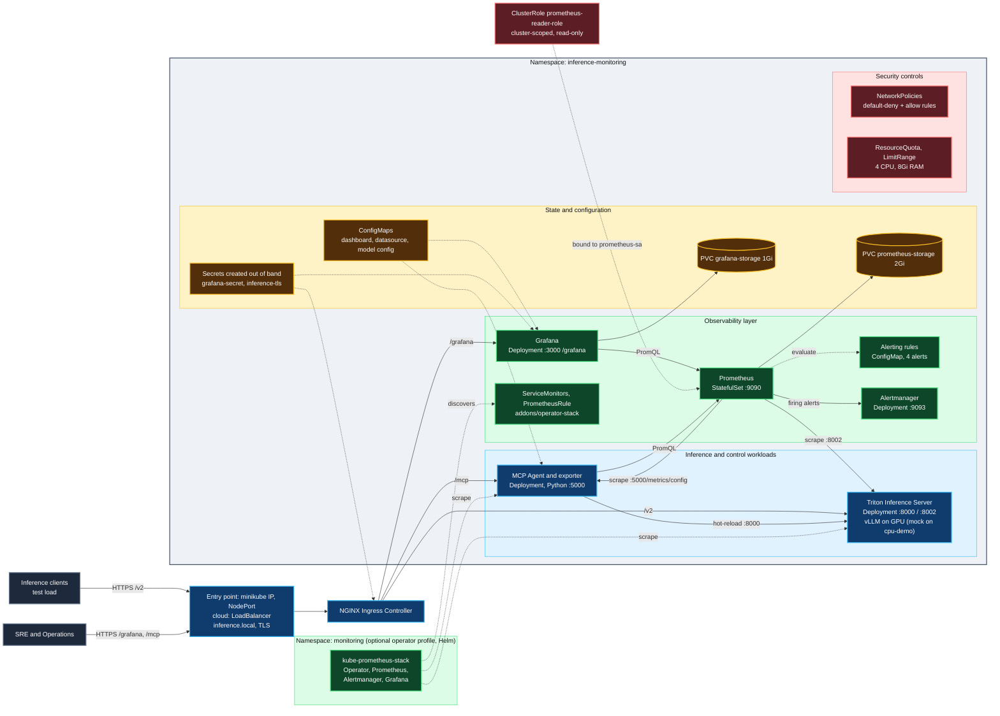
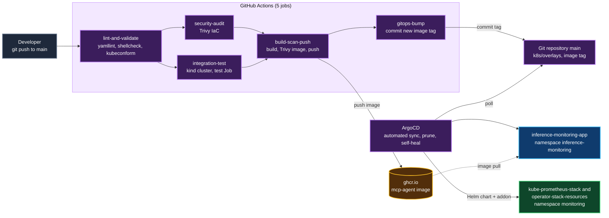

# Zadanie Cząstkowe 2: Opis Funkcjonalny, Architektura Systemu i Procedura Testowa

**Przedmiot:** Bezpieczeństwo CI/CD / Środowiska Chmurowe  
**Kategoria tematyczna:** Temat 3 – System zbierania metryk i monitoringu  
**Tytuł projektu:** *Autonomiczny system monitoringu, obserwacji wydajności i bezpiecznego zarządzania cyklem życia klastra inferencyjnego AI w środowisku Kubernetes z wykorzystaniem Prometheus, Grafana i GitOps*

---

## 1. Opis Podstawowej Funkcjonalności Systemu

System po wdrożeniu w klastrze **Kubernetes** (namespace `inference-monitoring`) realizuje produkcyjny stos obserwowalności (*observability*), sterowania ruchem i automatycznego utrzymania wydajności (*Self-Healing / SRE*) dla serwerów inferencji modeli sztucznej inteligencji:

1. **Wysokorozdzielcza obserwowalność inferencji AI (Prometheus TSDB):**
   * Agregacja w czasie rzeczywistym (interwał 1 s) kluczowych metryk wydajnościowych: czasu trwania żądania (`nv_inference_request_duration_us`), czasu oczekiwania w kolejce vLLM (`nv_inference_queue_duration_us`), liczby pomyślnych zapytań (`nv_inference_request_success`), obciążenia rdzeni GPU (`nv_gpu_utilization`) oraz pamięci VRAM.
   * Gwarancja trwałości danych analitycznych dzięki wdrożeniu Prometheusa jako **StatefulSet** powiązanego z trwałym wolumenem **PersistentVolumeClaim (PVC 2Gi)**.

2. **Wizualizacja stanu klastra w czasie rzeczywistym (Grafana UI):**
   * Prezentacja wskaźników SLA/SLO na automatycznie ładowanym (*auto-provisioned*) dashboardzie *Autonomous Inference Cluster*.
   * Panele monitorujące: bieżącą latencję (z progami ostrzegawczymi), przepustowość (RPS), głębokość kolejki, stan GPU oraz aktualną konfigurację batchingu w klastrze.

3. **Własny eksporter metryk i inteligentny kontroler SRE (MCP Agent w Pythonie):**
   * Mikroserwis pośredniczący udostępniający dedykowany endpoint `/metrics/config` (eksport parametrów silnika do Prometheusa).
   * Udostępnienie interfejsu API `/reconfigure` umożliwiającego dynamiczną rekonfigurację silnika (np. wielkości batcha `max_num_seqs`) w trybie *hot-reload* bez konieczności restartu podów i bez utraty dostępności serwisu.

4. **Proaktywne wykrywanie anomalii i alertowanie (Prometheus Alerting Rules):**
   * Ciągła ewaluacja zdefiniowanych deklaratywnie reguł alertów (`HighInferenceLatency`, `HighInferenceQueueDepth`, `GPUMemorySaturation`, `InferenceServerDown`) z natychmiastowym ostrzeganiem o nasyceniu zasobów lub awarii; aktywne alerty trafiają do Alertmanagera.

5. **Ścisłe utwardzenie bezpieczeństwa klastra (Zero-Trust & Hardening):**
   * Całkowita izolacja ruchu sieciowego za pomocą polityk **NetworkPolicy** (*default-deny-all* + reguły dedykowane).
   * Wdrożenie zasady najmniejszych uprawnień (**RBAC Least Privilege** dla Prometheusa – brak dostępu do sekretów i praw modyfikacji podów).
   * Uruchomienie wszystkich kontenerów w reżimie **Non-Root** (`securityContext: runAsNonRoot: true`, `capabilities: drop: ["ALL"]`) oraz ochrona węzłów przez `ResourceQuota` i `LimitRange`.

6. **Zarządzanie cyklem życia aplikacji według paradygmatu GitOps (ArgoCD):**
   * Deklaratywne odwzorowanie 100% stanu klastra w repozytorium Git z funkcją automatycznej synchronizacji (*Auto-Sync*) oraz samoczynnego przywracania stanu pożądanego (*Self-Healing*).

7. **Dostęp z zewnątrz (Ingress, TLS):**
   * Ingress NGINX (`ingressClassName: nginx`) wystawia Grafanę (`/grafana`), Triton (`/v2`) i MCP Agenta (`/mcp`) pod hostem `inference.local` z TLS. W Minikube kontroler Ingress jest usługą NodePort dostępną pod adresem `minikube ip`; w klastrze chmurowym kontroler otrzymuje adres od LoadBalancera dostawcy. Prometheus i Alertmanager nie są wystawiane (brak uwierzytelniania) – dostęp przez `port-forward`.
   * Sekrety (hasło Grafany, certyfikat TLS) nie są przechowywane w Git; tworzy je `scripts/bootstrap_secrets.sh`.

8. **Potok CI/CD i profil Prometheus Operator:**
   * GitHub Actions: lint i walidacja wszystkich overlayów (`kubeconform`), skan Trivy (IaC i obraz), test całej procedury na klastrze `kind`, wypchnięcie obrazu do `ghcr.io` i automatyczne podbicie jego tagu w Git, które uruchamia wdrożenie przez ArgoCD.
   * Opcjonalny profil z `ServiceMonitor`, `PrometheusRule` i chartem Helm `kube-prometheus-stack` (`k8s/addons/operator-stack`), wdrażany osobnymi aplikacjami ArgoCD.
---

## 2. Architektura Systemu (Forma Graficzna)

### 2.1. Diagram Architektury Przepływu w Klastrze Kubernetes

**Architektura klastra** (Architecture of the cluster):

**Dostarczanie: CI/CD i GitOps** (Delivery pipeline):

## 3. Procedura Testów Wdrożonego Systemu

Procedura testowa pozwala na obiektywną, powtarzalną i weryfikowalną ocenę osiągnięcia wszystkich celów projektowych:

### Test 1: Integralność wdrożenia klastra i weryfikacja limitów zasobów (Deployment & Quota Check)
* **Procedura:** Wykonanie inspekcji stanu wdrożenia poleceniami `kubectl get pods,pvc,svc -n inference-monitoring` oraz weryfikacja limitów przydziału `kubectl describe resourcequota -n inference-monitoring`.
* **Kryterium sukcesu (PASS):** Wszystkie 5 obciążeń (`prometheus-0`, `grafana`, `alertmanager`, `mcp-agent`, `triton-server`) raportują status `Running (1/1)` z liczbą restartów `0`. Wolumeny PVC `prometheus-storage-prometheus-0` i `grafana-storage` mają status `Bound`. Łączne zużycie zasobów mieści się w zdefiniowanej kwocie `inference-monitoring-quota`.

### Test 2: Audyt bezpieczeństwa środowiska K8s (RBAC, NetworkPolicy, Non-Root)
* **Procedura:** Uruchomienie zautomatyzowanego skryptu audytującego `./scripts/verify_security.sh`, testującego izolację sieciową, uprawnienia kont serwisowych oraz profile bezpieczeństwa kontenerów.
* **Kryterium sukcesu (PASS):**
  1. Polecenie `kubectl auth can-i` potwierdza, że konto `prometheus-sa` ma uprawnienie do odczytu podów (`yes`), ale **brak prawa do ich usuwania (`no`) oraz brak dostępu do sekretów (`no`)**.
  2. Wszystkie kontenery posiadają flagę `runAsNonRoot: true` (UID: 472, 10001, 65534).
  3. Polityki `NetworkPolicy` uniemożliwiają nieautoryzowany ruch między niepowiązanymi podami.

### Test 3: Weryfikacja potoku zbierania metryk i wizualizacji (Observability Pipeline)
* **Procedura:** Odpytanie API Prometheusa `http://localhost:9090/api/v1/targets` oraz weryfikacja dashboardu Grafany pod adresem `https://inference.local/grafana/`.
* **Kryterium sukcesu (PASS):** Cele scrapowania (`triton` na porcie 8002 oraz `mcp_agent_config` na porcie 5000) raportują stan `HEALTHY (up=1)`. Dashboard *Autonomous Inference Cluster* w Grafanie automatycznie wyświetla spójne serie czasowe (latencja, pamięć GPU, wielkość batcha) bez konieczności manualnej konfiguracji.

### Test 4: Reakcja systemu na syntetyczny skok obciążenia i wyzwolenie alertu (Load & Alert Triggering)
* **Procedura:** Uruchomienie procedury testowej wewnątrz klastra (`./scripts/run_in_cluster_test.sh`, Job z `scripts/test_k8s_simulation.py`) generującej skok ruchu z 20 RPS do serii 400 równoczesnych żądań na sekundę przez 15 sekund przy bazowej konfiguracji silnika inferencyjnego (`max_num_seqs` = 32).
* **Kryterium sukcesu (PASS):** Prometheus rejestruje wzrost średniego opóźnienia po stronie serwera (> 2× wartość bazowa i > 25 ms) oraz wzrost kolejki zapytań. W czasie $\le 15$ sekund reguła alertu `HighInferenceLatency` przechodzi ze stanu `OK` w stan aktywny `FIRING`, co jest widoczne w Prometheusie (`/api/v1/alerts`) i w Alertmanagerze.

### Test 5: Weryfikacja dynamicznej adaptacji SRE i powrotu do SLA (Hot-Reload & Latency Recovery)
* **Procedura:** Wywołanie procedury optymalizacyjnej przez kontroler SRE (`POST /reconfigure` ze strategią `aggressive` – zwiększenie parametru `max_num_seqs` z 32 do 512) w trakcie trwającego obciążenia 150 RPS.
* **Kryterium sukcesu (PASS):**
  1. Kontroler dokonuje bezprzerwowej rekonfiguracji Tritona (*zero-downtime hot reload* – 100% zapytań zwraca kod 200).
  2. Metryka `triton_config_max_num_seqs` w Prometheusie aktualizuje się do wartości `512`.
  3. Średnie opóźnienie serwera spada o ponad 50% względem fazy burzy (powrót poniżej 30 ms), a alert `HighInferenceLatency` samoczynnie powraca do stanu `RESOLVED`.

> **Wariant GPU (Testy 4 i 5):** na prawdziwym Triton z vLLM (`TEST_PROFILE=gpu`) kryteria są te same, ale opóźnienie porównywane jest end-to-end z poziomu klastra, a silnik startuje od `max_num_seqs = 4`; hot-reload zmienia `model.json` (argumenty silnika vLLM) i przeładowuje model.

### Test 6: GitOps – synchronizacja i self-heal (ArgoCD)
* **Procedura:** `kubectl apply -f k8s/gitops/argocd-application.yaml`, odczekanie na synchronizację (`kubectl -n argocd get app inference-monitoring-app`), a następnie ręczne usunięcie `alertmanager-service` i wyzerowanie replik Grafany (`kubectl scale deploy/grafana --replicas=0`).
* **Kryterium sukcesu (PASS):** aplikacja osiąga stan `Synced/Healthy`, pod `mcp-agent` używa obrazu z `ghcr.io`, a obie ręczne zmiany są cofane przez ArgoCD w ciągu kilkudziesięciu sekund.

### Test 7: Profil Prometheus Operator (ServiceMonitor, Helm)
* **Procedura:** `OPERATOR_PROFILE=true ./scripts/bootstrap_secrets.sh`, `kubectl apply -f k8s/gitops/argocd-application-operator.yaml`, następnie odpytanie `http://localhost:19090/api/v1/targets` i `/api/v1/rules` po `kubectl -n monitoring port-forward svc/kps-prometheus 19090:9090`.
* **Kryterium sukcesu (PASS):** cele `serviceMonitor/inference-monitoring/triton/0` i `serviceMonitor/inference-monitoring/mcp-agent-config/0` mają stan `up`, grupa `inference_alerts` zawiera 4 reguły, Alertmanager z chartu jest aktywny.

### Test 8: Potok CI/CD (GitHub Actions)
* **Procedura:** push na gałąź `main`.
* **Kryterium sukcesu (PASS):** wszystkie 5 jobów kończy się sukcesem (lint i walidacja overlayów, Trivy IaC, test w klastrze `kind` z kryteriami z Testów 4–5, zbudowanie i skan obrazu z wypchnięciem do `ghcr.io`, automatyczne podbicie tagu obrazu w Git).
