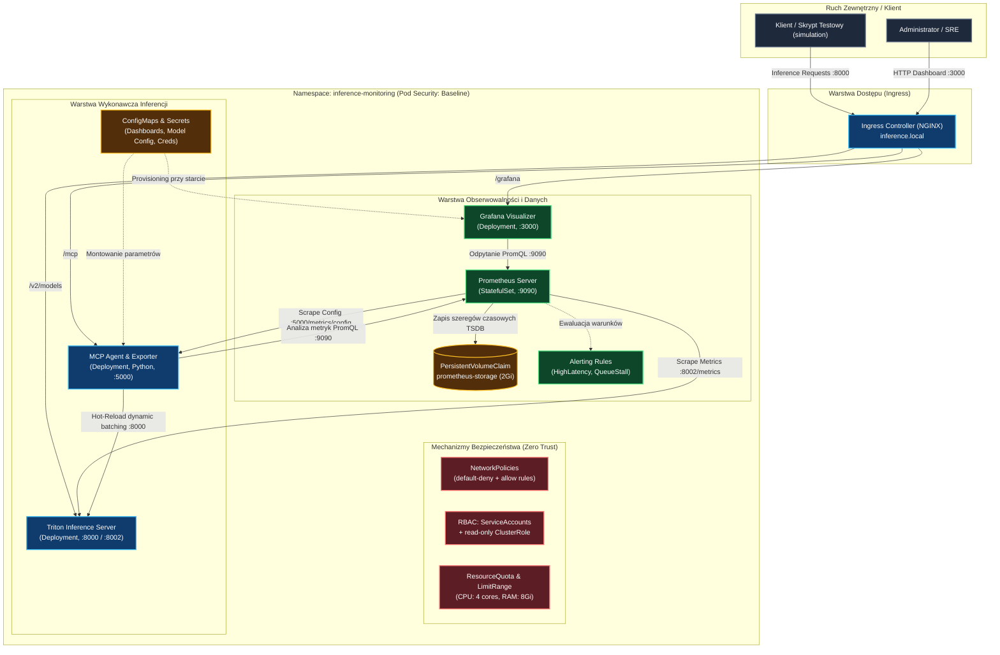

# Zadanie Cząstkowe 2: Opis Funkcjonalny, Architektura Systemu i Procedura Testowa

**Przedmiot:** Bezpieczeństwo CI/CD / Środowiska Chmurowe  
**Kategoria tematyczna:** Temat 3 – System zbierania metryk i monitoringu  
**Tytuł projektu:** *Autonomiczny system monitoringu, obserwacji wydajności i bezpiecznego zarządzania cyklem życia klastra inferencyjnego AI w środowisku Kubernetes z wykorzystaniem Prometheus, Grafana i GitOps*

---

## 1. Opis Podstawowej Funkcjonalności Systemu

System po wdrożeniu w klastrze **Kubernetes** (namespace `inference-monitoring`) realizuje produkcyjny stos obserwowalności (*observability*), sterowania ruchem i automatycznego utrzymania wydajności (*Self-Healing / SRE*) dla serwerów inferencji modeli sztucznej inteligencji:

1. **Wysokorozdzielcza obserwowalność inferencji AI (Prometheus TSDB):**
   * Agregacja w czasie rzeczywistym (interwał 1 s) kluczowych metryk wydajnościowych: czasu trwania żądania (`nv_inference_request_duration_us`), czasu oczekiwania w kolejce vLLM (`nv_inference_queue_duration_us`), liczby pomyślnych zapytań (`nv_inference_request_success`), obciążenia rdzeni GPU (`nv_gpu_utilization`) oraz pamięci VRAM.
   * Gwarancja trwałości danych analitycznych dzięki wdrożeniu Prometheusa jako **StatefulSet** powiązanego z trwałym wolumenem **PersistentVolumeClaim (PVC 2Gi)**.

2. **Wizualizacja stanu klastra w czasie rzeczywistym (Grafana UI):**
   * Prezentacja wskaźników SLA/SLO na automatycznie ładowanym (*auto-provisioned*) dashboardzie *Autonomous Inference Cluster*.
   * Panele monitorujące: bieżącą latencję (z progami ostrzegawczymi), przepustowość (RPS), głębokość kolejki, stan GPU oraz aktualną konfigurację batchingu w klastrze.

3. **Własny eksporter metryk i inteligentny kontroler SRE (MCP Agent w Pythonie):**
   * Mikroserwis pośredniczący udostępniający dedykowany endpoint `/metrics/config` (eksport parametrów silnika do Prometheusa).
   * Udostępnienie interfejsu API `/reconfigure` umożliwiającego dynamiczną rekonfigurację silnika (np. wielkości batcha `max_num_seqs`) w trybie *hot-reload* bez konieczności restartu podów i bez utraty dostępności serwisu.

4. **Proaktywne wykrywanie anomalii i alertowanie (Prometheus Alerting Rules):**
   * Ciągła ewaluacja zdefiniowanych deklaratywnie reguł alertów (`HighInferenceLatency`, `HighInferenceQueueDepth`, `GPUMemorySaturation`, `InferenceServerDown`) z natychmiastowym ostrzeganiem o nasyceniu zasobów lub awarii.

5. **Ścisłe utwardzenie bezpieczeństwa klastra (Zero-Trust & Hardening):**
   * Całkowita izolacja ruchu sieciowego za pomocą polityk **NetworkPolicy** (*default-deny-all* + reguły dedykowane).
   * Wdrożenie zasady najmniejszych uprawnień (**RBAC Least Privilege** dla Prometheusa – brak dostępu do sekretów i praw modyfikacji podów).
   * Uruchomienie wszystkich kontenerów w reżimie **Non-Root** (`securityContext: runAsNonRoot: true`, `capabilities: drop: ["ALL"]`) oraz ochrona węzłów przez `ResourceQuota` i `LimitRange`.

6. **Zarządzanie cyklem życia aplikacji według paradygmatu GitOps (ArgoCD):**
   * Deklaratywne odwzorowanie 100% stanu klastra w repozytorium Git z funkcją automatycznej synchronizacji (*Auto-Sync*) oraz samoczynnego przywracania stanu pożądanego (*Self-Healing*).

---

## 2. Architektura Systemu (Forma Graficzna)

### 2.1. Diagram Architektury Przepływu w Klastrze Kubernetes

## 3. Procedura Testów Wdrożonego Systemu

Procedura testowa pozwala na obiektywną, powtarzalną i weryfikowalną ocenę osiągnięcia wszystkich celów projektowych:

### Test 1: Integralność wdrożenia klastra i weryfikacja limitów zasobów (Deployment & Quota Check)
* **Procedura:** Wykonanie inspekcji stanu wdrożenia poleceniami `kubectl get pods,pvc,svc -n inference-monitoring` oraz weryfikacja limitów przydziału `kubectl describe resourcequota -n inference-monitoring`.
* **Kryterium sukcesu (PASS):** Wszystkie 4 obciążenia (`prometheus-0`, `grafana`, `mcp-agent`, `triton-server`) raportują status `Running (1/1)` z liczbą restartów `0`. Wolumen PVC bazy Prometheus ma status `Bound`. Łączne zużycie zasobów mieści się w zdefiniowanej kwocie `inference-monitoring-quota`.

### Test 2: Audyt bezpieczeństwa środowiska K8s (RBAC, NetworkPolicy, Non-Root)
* **Procedura:** Uruchomienie zautomatyzowanego skryptu audytującego `./scripts/verify_security.sh`, testującego izolację sieciową, uprawnienia kont serwisowych oraz profile bezpieczeństwa kontenerów.
* **Kryterium sukcesu (PASS):**
  1. Polecenie `kubectl auth can-i` potwierdza, że konto `prometheus-sa` ma uprawnienie do odczytu podów (`yes`), ale **brak prawa do ich usuwania (`no`) oraz brak dostępu do sekretów (`no`)**.
  2. Wszystkie kontenery posiadają flagę `runAsNonRoot: true` (UID: 472, 10001, 65534).
  3. Polityki `NetworkPolicy` uniemożliwiają nieautoryzowany ruch między niepowiązanymi podami.

### Test 3: Weryfikacja potoku zbierania metryk i wizualizacji (Observability Pipeline)
* **Procedura:** Odpytanie API Prometheusa `http://localhost:9090/api/v1/targets` oraz weryfikacja dashboardu Grafany pod adresem `http://localhost:3000`.
* **Kryterium sukcesu (PASS):** Cele scrapowania (`triton` na porcie 8002 oraz `mcp_agent_config` na porcie 5000) raportują stan `HEALTHY (up=1)`. Dashboard *Autonomous Inference Cluster* w Grafanie automatycznie wyświetla spójne serie czasowe (latencja, pamięć GPU, wielkość batcha) bez konieczności manualnej konfiguracji.

### Test 4: Reakcja systemu na syntetyczny skok obciążenia i wyzwolenie alertu (Load & Alert Triggering)
* **Procedura:** Uruchomienie skryptu symulacyjnego `python3 scripts/test_k8s_simulation.py` generującego gwałtowny skok ruchu z 20 RPS do 150 RPS przez 15 sekund przy bazowej konfiguracji silnika inferencyjnego.
* **Kryterium sukcesu (PASS):** Prometheus rejestruje natychmiastowy wzrost opóźnień P95 > 50 ms oraz wzrost kolejki zapytań. W czasie $\le 15$ sekund reguła alertu `HighInferenceLatency` przechodzi ze stanu `OK` w stan aktywny `FIRING`, co zostaje odnotowane w Grafanie i Prometheus Alertmanagerze.

### Test 5: Weryfikacja dynamicznej adaptacji SRE i powrotu do SLA (Hot-Reload & Latency Recovery)
* **Procedura:** Wywołanie procedury optymalizacyjnej przez kontroler SRE (`POST /reconfigure` ze strategią `aggressive` – zwiększenie parametru `max_num_seqs` z 32 do 512) w trakcie trwającego obciążenia 150 RPS.
* **Kryterium sukcesu (PASS):**
  1. Kontroler dokonuje bezprzerwowej rekonfiguracji Tritona (*zero-downtime hot reload* – 100% zapytań zwraca kod 200).
  2. Metryka `triton_config_max_num_seqs` w Prometheusie aktualizuje się do wartości `512`.
  3. Średnie opóźnienie żądań spada o ponad 50% (powrót poniżej 30 ms), a alert `HighInferenceLatency` samoczynnie powraca do stanu `RESOLVED`.
