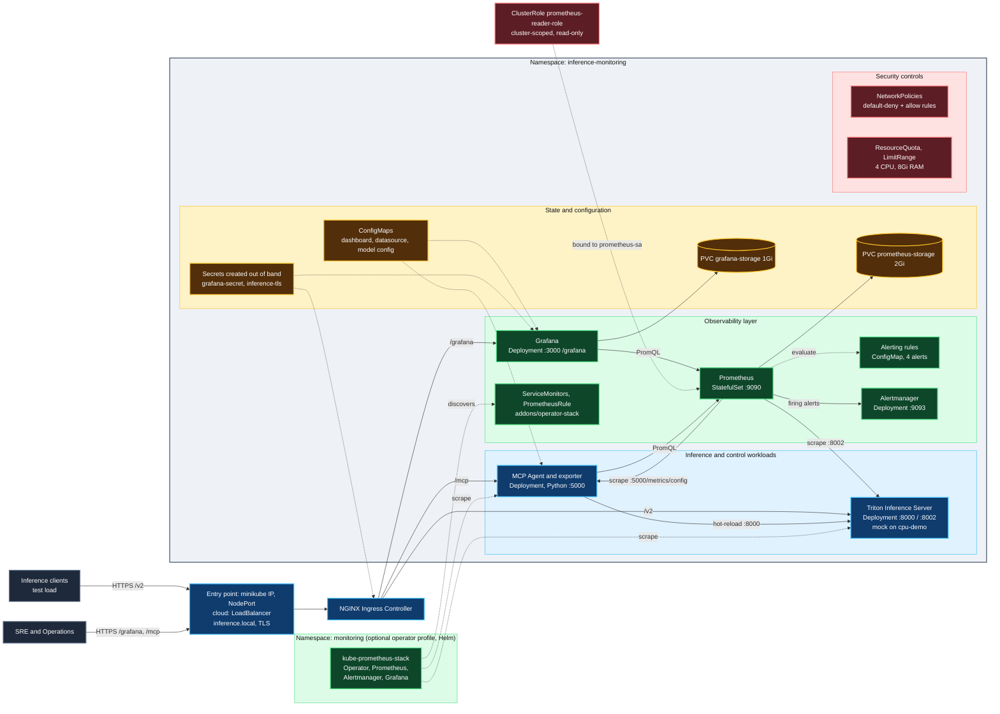
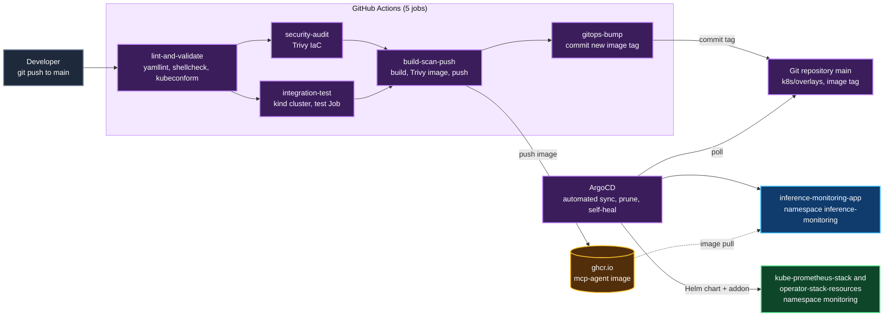

# Zadanie Cząstkowe 3: Implementacja w Kubernetes i Sprawozdanie z Realizacji Testów

**Przedmiot:** Bezpieczeństwo CI/CD / Zaawansowane Środowiska Chmurowe i Konteneryzacja
**Temat:** 3 – System zbierania metryk i monitoringu (Prometheus + Grafana + własny eksporter)
**Data weryfikacji:** 2026-10-31 (klaster Minikube + GitHub Actions)

## Linki do projektu (repozytorium publiczne)

| Zasób | Adres |
| :--- | :--- |
| Repozytorium (kod, manifesty, dokumentacja) | https://github.com/Shengan01/Inference-Server |
| GitHub Actions (potok CI/CD, wszystkie przebiegi) | https://github.com/Shengan01/Inference-Server/actions |
| Definicja potoku | https://github.com/Shengan01/Inference-Server/blob/main/.github/workflows/ci-cd.yaml |
| Przykładowy przebieg z raportem testów (artefakt `test-report`) | https://github.com/Shengan01/Inference-Server/actions/runs/41239646305 |
| Historia zmian (commity) | https://github.com/Shengan01/Inference-Server/commits/main |
| Manifesty Kubernetes (`base`, `overlays`, `addons`, `gitops`) | https://github.com/Shengan01/Inference-Server/tree/main/k8s |
| Obraz kontenera (GitHub Container Registry) | https://github.com/Shengan01/Inference-Server/pkgs/container/mcp-agent |
| Instrukcja uruchomienia i testów | https://github.com/Shengan01/Inference-Server/blob/main/docs/INSTRUKCJA_URUCHOMIENIA_I_TESTOW.md |

Projekt dotyczy zarządzania klastrem Kubernetes: wdrożenia, bezpieczeństwa, obserwowalności, CI/CD i GitOps. Serwowany model (mock Triton) jest tu tylko obciążeniem generującym metryki.

---

## 1. Zakres projektu i zgodność z wymaganiami tematu 3

| Wymaganie | Realizacja | Gdzie w repozytorium |
| :--- | :--- | :--- |
| Prometheus jako StatefulSet | StatefulSet z `volumeClaimTemplates` (PVC 2Gi), retencja 15 dni | `k8s/base/prometheus/statefulset.yaml` |
| Grafana jako Deployment | Deployment z PVC 1Gi, provisioning źródła danych i dashboardu z ConfigMap, serwowana pod `/grafana` | `k8s/base/grafana/` |
| Własne dashboardy | *Autonomous Inference Cluster* (9 paneli) | `grafana/dashboards/inference-cluster.json` |
| Własne alerty | 4 reguły (`InferenceServerDown`, `HighInferenceLatency`, `HighInferenceQueueDepth`, `GPUMemorySaturation`) + Alertmanager | `k8s/base/prometheus/alerting-rules.yaml`, `k8s/base/alertmanager/` |
| ServiceMonitor | 2 ServiceMonitory (`triton`, `mcp-agent-config`) | `k8s/addons/operator-stack/servicemonitors.yaml` |
| RBAC dla Prometheusa | `ServiceAccount` + `ClusterRole` tylko do odczytu + binding | `k8s/base/rbac.yaml` |
| Helm / `kube-prometheus-stack` | chart 58.2.2 z własnymi wartościami, wdrażany przez ArgoCD | `k8s/addons/operator-stack/helm-values.yaml`, `k8s/gitops/argocd-application-operator.yaml` |
| Własny eksporter w Pythonie | `mcp_agent` udostępnia `/metrics/config` (parametry silnika) i `/reconfigure` | `mcp_agent/server.py` |
| Wskazówki z laboratoriów | | |
| – CI/CD | GitHub Actions: lint, walidacja, Trivy, test na `kind`, obraz do `ghcr.io`, podbicie tagu w Git | `.github/workflows/ci-cd.yaml` |
| – Ingress / gateway | NGINX Ingress, TLS, host `inference.local`, ścieżki `/grafana`, `/v2`, `/mcp` | `k8s/base/ingress/ingress.yaml` |
| – Frontend (wykresy) | Grafana | `https://inference.local/grafana/` |
| – Dostęp z zewnątrz / LoadBalancer | Ingress dostępny pod `minikube ip` (NodePort); w chmurze kontroler dostaje LoadBalancer | rozdz. 6 |
| Zadanie 4 (opcjonalne): GitOps | 3 aplikacje ArgoCD (rdzeń, chart Helm, zasoby operatora) | `k8s/gitops/` |

## 2. Architektura

**Architektura klastra** (Architecture of the cluster):

**Dostarczanie: CI/CD i GitOps** (Delivery pipeline):

Opis przepływów: ruch zewnętrzny trafia przez Ingress (TLS) do Grafany, Tritona lub MCP Agenta. Prometheus zbiera metryki z Tritona (`:8002/metrics`) i z eksportera agenta (`:5000/metrics/config`), zapisuje je na PVC, ocenia reguły i wysyła aktywne alerty do Alertmanagera. Agent odpytuje Prometheusa i przeładowuje konfigurację Tritona (hot-reload). Dostarczanie: GitHub Actions testuje i buduje obraz, zapisuje nowy tag w Git, a ArgoCD synchronizuje klaster. Profil operatora (`monitoring`) jest opcjonalny.

## 3. Implementacja – najważniejsze decyzje

* **Podział StatefulSet / Deployment:** baza TSDB Prometheusa jako StatefulSet ze stałym wolumenem; Grafana, Alertmanager, agent i Triton jako Deployment.
* **Konfiguracja deklaratywna:** datasource, dashboard, reguły alertów i konfiguracje w ConfigMap; **sekrety poza Git** (`scripts/bootstrap_secrets.sh` tworzy losowe hasło Grafany i certyfikat TLS).
* **Bezpieczeństwo:** `default-deny-all` + reguły dla każdej pary komunikujących się usług, wszystkie kontenery `runAsNonRoot`, `allowPrivilegeEscalation: false`, `drop: ALL`, `seccomp: RuntimeDefault`, ResourceQuota i LimitRange, RBAC najmniejszych uprawnień. Obraz agenta działa jako UID 10001, bez `setuptools` i `wheel` (usunięte po skanie Trivy).
* **Profile uruchomieniowe:** `cpu-demo` (mock Tritona) i `gpu` (prawdziwy Triton, zasób `nvidia.com/gpu`); overlaye `local-*` używają obrazu zbudowanego lokalnie.
* **CI/CD:** pięć jobów (rozdz. 7 instrukcji); każdy etap jest bramką, a porażka testu w klastrze przerywa pipeline.
* **GitOps:** `automated` sync z `prune` i `selfHeal`; tag obrazu aktualizuje job `gitops-bump`.

## 4. Procedura testowa

Opis każdego testu i kryteria PASS znajdują się w `docs/ZADANIE_2_OPIS_I_ARCHITEKTURA.md` (rozdz. 3, testy 1–8); sposób uruchomienia w `docs/INSTRUKCJA_URUCHOMIENIA_I_TESTOW.md`.

## 5. Sprawozdanie z realizacji testów

Środowisko: Minikube (Docker, Kubernetes v1.35) i runner GitHub Actions z klastrem `kind`. Obraz agenta: `ghcr.io/shengan01/mcp-agent:22262ec…`.

| # | Test | Wynik | Dowód |
| :-: | :--- | :-: | :--- |
| 1 | Integralność wdrożenia i quota | **PASS** | 5 podów `Running` (`prometheus-0`, `grafana`, `alertmanager`, `mcp-agent`, `triton-server`); PVC `prometheus-storage-prometheus-0` (2Gi) i `grafana-storage` (1Gi) `Bound`; quota: pody 5/15, requests.cpu 550m/4, requests.memory 768Mi/8Gi, PVC 2/5 |
| 2 | Audyt bezpieczeństwa | **PASS** | `prometheus-sa`: odczyt podów `yes`, usuwanie podów `no`, odczyt Secrets `no`; wszystkie pody `NonRoot: true` (UID 472, 10001, 65534); 7 NetworkPolicy z profilu podstawowego aktywnych (+3 pomocnicze: 2 dla Jobu testowego, 1 dla profilu operatora); brak jawnego hasła w manifestach |
| 3 | Potok metryk i wizualizacji | **PASS** | cele Prometheusa `prometheus`, `triton`, `mcp_agent_config` = `up`; Alertmanager podłączony (1); Grafana: źródło `Prometheus` (`http://prometheus-service:9090`) i dashboard *Autonomous Inference Cluster* załadowane automatycznie; `https://inference.local/grafana/api/health`, `/v2/health/ready`, `/mcp/health` = 200; `http://` przekierowuje na HTTPS (308) |
| 4 | Skok obciążenia i alert | **PASS** | opóźnienie serwera 15,7 → 170,6 ms (Minikube) i 15,8 → 65,2 ms (CI); aktywny alert `HighInferenceQueueDepth` |
| 5 | Hot-reload i powrót do normy | **PASS** | `/reconfigure` zwraca 200 (`max_num_seqs`: 512, `hot_reload: true`); opóźnienie serwera po zmianie 14,2 ms (Minikube) i 13,4 ms (CI); 100% żądań z kodem 200 |
| 6 | GitOps: synchronizacja i self-heal | **PASS** | aplikacja `Synced/Healthy`, pod agenta z obrazem `ghcr.io/…`; po usunięciu `alertmanager-service` i wyzerowaniu replik Grafany ArgoCD przywrócił oba w kilka sekund |
| 7 | Profil operatora | **PASS** | `serviceMonitor/inference-monitoring/triton/0` i `…/mcp-agent-config/0` = `up`; grupa `inference_alerts` (4 reguły) załadowana; Alertmanager z chartu aktywny |
| 8 | Potok CI/CD | **PASS** | ostatni przebieg ([run 41242149834](https://github.com/Shengan01/Inference-Server/actions/runs/41242149834)): 5/5 jobów zielone |

**Weryfikacja instrukcji od zera.** Dokument `INSTRUKCJA_URUCHOMIENIA_I_TESTOW.md` został wykonany w całości na czystym klastrze Minikube (osobny profil, 2026-11-01): wdrożenie skryptem w ok. 1 minutę, audyt bezpieczeństwa, test obciążeniowy (opóźnienie serwera 15,7 → 213,6 → 14,6 ms, dwa kolejne przebiegi PASS), instalacja ArgoCD ze self-heal, profil operatora (oba ServiceMonitory `up`) oraz sprzątanie.

### 5.1. Wyniki testów 4 i 5 (procedura obciążeniowa)

Źródło: raport z przebiegu CI ([run 41239646305](https://github.com/Shengan01/Inference-Server/actions/runs/41239646305), artefakt `test-report`) oraz ten sam test uruchomiony na Minikube.

| Faza | Żądań/s | Wysłane | Pomyślne | Opóźnienie serwera CI (ms) | Opóźnienie serwera Minikube (ms) |
| :--- | :---: | :---: | :---: | :---: | :---: |
| 1. THE CALM | 20 | 200 | 100% | 15,8 | 15,7 |
| 2. THE STORM | 400 | 3600 (CI) / 6000 (Minikube) | 100% | **65,2** | **170,6** |
| 3. THE RESOLUTION | 400 | 3600 (CI) / 6000 (Minikube) | 100% | **13,4** | **14,2** |

Wszystkie 7 kryteriów PASS w obu uruchomieniach: skuteczność ≥ 95% (fazy 1 i 3), `/reconfigure` = 200, cele Prometheusa `up` i reguły załadowane, burza podnosi opóźnienie serwera ponad 2× wartość bazową i powyżej 25 ms, po hot-reload opóźnienie spada poniżej 30 ms i poniżej połowy wartości z burzy.

**Jak czytać wyniki.** Opóźnienie serwera liczone jest z liczników Prometheusa (`Δ nv_inference_request_duration_us / Δ nv_inference_request_success`), czyli tak samo jak w regule alertu. Opóźnienie mierzone po stronie klienta (kilkaset ms przy 400 równoczesnych żądaniach) zależy głównie od mocy procesu generatora i nie opisuje usługi. Wartości bezwzględne zależą od mocy maszyny i modelu opóźnień mocka, dlatego CI i Minikube różnią się w fazie burzy; istotny jest kierunek zmiany i powrót do wartości bazowej.

## 6. Ograniczenia i uwagi

* Profil `cpu-demo` używa **mocka Tritona**; profil `gpu` (prawdziwy Triton + GPU) jest przygotowany i renderuje się poprawnie, ale nie był uruchamiany (brak GPU).
* Podczas testu zaobserwowano alert `HighInferenceQueueDepth`; `HighInferenceLatency` nie został zaobserwowany jako aktywny w raporcie (zależy od okna `rate(...[15s])`).
* Alertmanager nie ma skonfigurowanego odbiorcy (webhook/e-mail); alerty są widoczne w jego interfejsie i w Prometheusie.
* TLS jest self-signed; w produkcji należy użyć cert-manager. Sekrety tworzone są skryptem, nie przez Sealed/External Secrets.
* W Minikube kontroler Ingress jest usługą NodePort pod `minikube ip`. Wariant z LoadBalancerem (`minikube tunnel`) nie był testowany.
* `ClusterRole` Prometheusa jest przygotowana pod Service Discovery, a profil standardowy używa statycznych celów scrapowania; wykrywanie przez ServiceMonitor działa w profilu operatora.
* Własny dashboard jest dostarczany w profilu standardowym; Grafana z chartu operatora ma domyślne dashboardy Kubernetes.

## 7. Wnioski

System realizuje wszystkie elementy tematu 3: Prometheus jako StatefulSet z trwałym wolumenem, Grafana z automatycznie ładowanym dashboardem, własny eksporter, alerty z Alertmanagerem, RBAC, ServiceMonitory i chart Helm. Dodatkowo zapewnia dostęp przez Ingress z TLS, zabezpieczenia sieciowe i kontenerowe oraz zautomatyzowany potok CI/CD zintegrowany z GitOps. Wszystkie testy zakończyły się wynikiem pozytywnym, a procedurę testową można powtórzyć jednym poleceniem (`scripts/run_in_cluster_test.sh`) lub zobaczyć w artefaktach GitHub Actions.
