# Zadanie Cząstkowe 3: Implementacja w Kubernetes i Sprawozdanie z Realizacji Testów

**Przedmiot:** Bezpieczeństwo CI/CD / Zaawansowane Środowiska Chmurowe i Konteneryzacja
**Temat:** 3 – System zbierania metryk i monitoringu (Prometheus + Grafana + własny eksporter w Pythonie)
**Data wykonania zrzutów i testów:** 2026-11-05 (Minikube z GPU NVIDIA RTX 4080 SUPER + GitHub Actions)

## Linki do projektu (repozytorium publiczne)

| Zasób | Adres |
| :--- | :--- |
| **B. Repozytorium z manifestami** | https://github.com/Shengan01/Inference-Server |
| Manifesty Kubernetes (`base`, `overlays`, `addons`, `gitops`, `tests`, `examples`) | https://github.com/Shengan01/Inference-Server/tree/main/k8s |
| README repozytorium | https://github.com/Shengan01/Inference-Server/blob/main/README.md |
| GitHub Actions (potok CI/CD, wszystkie przebiegi) | https://github.com/Shengan01/Inference-Server/actions |
| Definicja potoku | https://github.com/Shengan01/Inference-Server/blob/main/.github/workflows/ci-cd.yaml |
| Przykładowy przebieg z raportem testów (artefakt `test-report`) | https://github.com/Shengan01/Inference-Server/actions/runs/41239646305 |
| Obraz kontenera (GitHub Container Registry) | https://github.com/Shengan01/Inference-Server/pkgs/container/mcp-agent |
| Instrukcja uruchomienia i testów | https://github.com/Shengan01/Inference-Server/blob/main/docs/INSTRUKCJA_URUCHOMIENIA_I_TESTOW.md |

**Zawartość sprawozdania.** Część **A** (rozdz. 1–3): potwierdzenie wdrożenia w klastrze (polecenia + zrzuty), prezentacja testów z Zadania 2 (cel, polecenia, zrzuty, wyniki) oraz komentarz do funkcjonalności. Część **B** (rozdz. 4): link do repozytorium z manifestami i opis jego zawartości. Zrzuty z terminala przedstawiają rzeczywisty wynik poleceń uruchomionych na klastrze (generowane skryptem `scripts/capture_evidence.py`), a zrzuty interfejsów (Prometheus, Grafana, Alertmanager, GitHub Actions) są zrzutami z przeglądarki.

---

# Część A

## 1. Potwierdzenie wdrożenia w klastrze Kubernetes

**Środowisko:** jednowęzłowy klaster Minikube (sterownik Docker, Kubernetes v1.35) z dostępem do **GPU NVIDIA GeForce RTX 4080 SUPER (16 GB)**, namespace `inference-monitoring`. Serwer inferencji to **prawdziwy Triton z backendem vLLM** (obraz `tritonserver:24.06-vllm-python-py3`) obsługujący model Qwen2-1.5B (GPTQ) na GPU. System wdrożono dwiema równoważnymi ścieżkami: skryptem lokalnym oraz GitOps (ArgoCD synchronizuje klaster z repozytorium).

```bash
./scripts/deploy_minikube_gpu.sh                           # klaster Minikube z GPU + wdrożenie lokalne (overlay local-gpu)
kubectl apply -f k8s/gitops/argocd-application-gpu.yaml    # wdrożenie GitOps (overlay gpu z gałęzi main)
```

### 1.1. Mapa wymaganych obiektów

| Obiekt | Konfiguracja w projekcie | Manifest | Zrzut |
| :--- | :--- | :--- | :---: |
| **StatefulSet** | `prometheus`: stała tożsamość, `volumeClaimTemplates` (2Gi), retencja 15 dni, probes, `securityContext` | `k8s/base/prometheus/statefulset.yaml` | 1.3 |
| **Deployment** | `grafana`, `alertmanager`, `mcp-agent` (eksporter), `triton-server` (Triton + vLLM, zasób `nvidia.com/gpu`); probes (w tym `startupProbe` dla ładowania modelu), strategia `Recreate` (PVC RWO, jedno GPU) | `k8s/base/*/deployment.yaml`, `k8s/overlays/gpu/` | 1.3 |
| **Service** | 5 × `ClusterIP` (Prometheus, Alertmanager, Grafana, Triton, MCP Agent), nazwane porty | `k8s/base/*/service.yaml` | 1.4 |
| **Ingress** | NGINX, TLS, host `inference.local`; ścieżki `/grafana`, `/v2`, `/mcp` (rewrite) | `k8s/base/ingress/ingress.yaml` | 1.4 |
| **PVC** | `prometheus-storage-prometheus-0` 2Gi (z szablonu StatefulSet), `grafana-storage` 1Gi, `model-repository` 5Gi (wspólny dla Tritona i agenta; PV `hostPath`) | `k8s/base/grafana/pvc.yaml`, StatefulSet, `k8s/overlays/gpu/model-storage.yaml` | 1.5 |
| **ConfigMap** | konfiguracja Prometheusa i Alertmanagera, reguły alertów, datasource i dashboard Grafany, `config.pbtxt` i `model.json` modelu | `k8s/base/*/configmap*.yaml`, `k8s/overlays/gpu/model-json-configmap.yaml` | 1.6 |
| **Secret** | `grafana-secret` (Opaque), `inference-tls` (`kubernetes.io/tls`); tworzone skryptem, bez wartości w Git; wzór w repozytorium | `scripts/bootstrap_secrets.sh`, `k8s/examples/secrets.example.yaml` | 1.6 |
| **NetworkPolicy** | `default-deny-all` + 6 reguł dla każdej pary komunikujących się usług | `k8s/base/network-policy.yaml` | 1.7 |
| **Requests i limits** | jawne `requests` i `limits` CPU/pamięć w każdym kontenerze (także init-container) | manifesty workloadów | 1.8 |
| **ResourceQuota** | 4 CPU / 8Gi (requests), 8 CPU / 16Gi (limits), 5 PVC, 15 podów | `k8s/base/resource-quota.yaml` | 1.8 |
| **LimitRange** | domyślne requests/limits kontenera oraz zakres 500Mi–10Gi dla PVC | `k8s/base/resource-quota.yaml` | 1.8 |

### 1.2. Klaster i namespace

```bash
kubectl get nodes -o wide && kubectl get namespaces
```
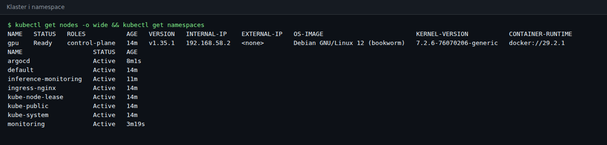

### 1.3. Deployment i StatefulSet

```bash
kubectl -n inference-monitoring get deployments,statefulsets,pods
```
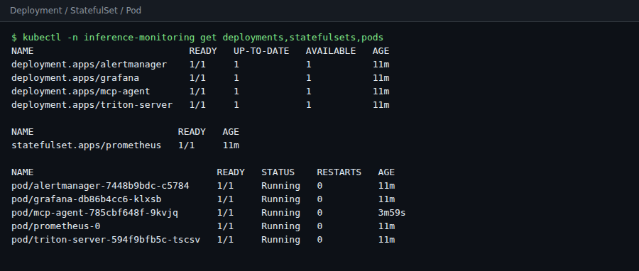

Komentarz: Prometheus działa jako StatefulSet (dane szeregów czasowych na trwałym wolumenie), pozostałe komponenty jako Deployment. Wszystkie pody są w stanie `Running 1/1`.

Serwer inferencji korzysta z GPU: węzeł udostępnia Kubernetesowi zasób `nvidia.com/gpu` (wtyczka urządzeń NVIDIA), a pod Tritona widzi kartę:

```bash
kubectl describe node | grep nvidia.com/gpu
kubectl -n inference-monitoring exec deploy/triton-server -c triton-server -- nvidia-smi --query-gpu=name,memory.used,memory.total --format=csv
```
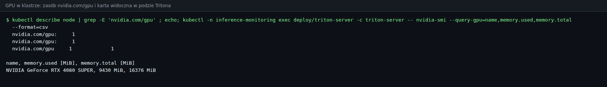

Model jest załadowany w prawdziwym Triton (backend vLLM) i generuje tekst:

```bash
kubectl -n inference-monitoring exec deploy/triton-server -c triton-server -- curl -s -X POST localhost:8000/v2/models/finance-qwen/generate -d '{"text_input":"...","parameters":{"stream":false,"max_tokens":24}}'
```
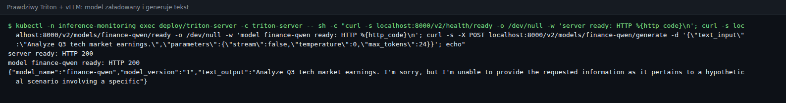

### 1.4. Service i Ingress

```bash
kubectl -n inference-monitoring get services,ingress
IP=$(minikube ip); curl -sk --resolve inference.local:443:$IP https://inference.local/grafana/api/health
```
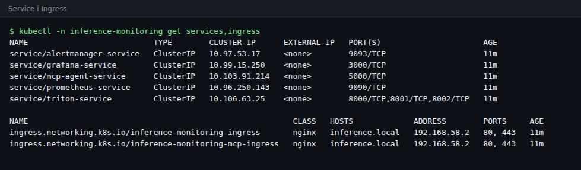

Dostęp zewnętrzny przez Ingress (TLS, kody odpowiedzi i przekierowanie HTTP → HTTPS):

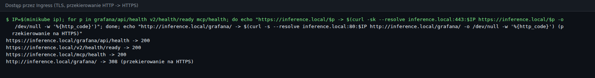

### 1.5. PersistentVolumeClaim

```bash
kubectl -n inference-monitoring get pvc && kubectl get pv
```
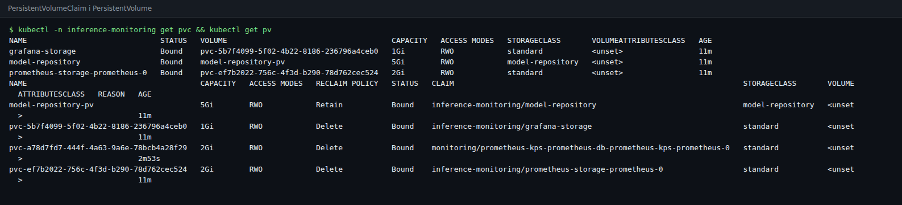

### 1.6. ConfigMap i Secret

```bash
kubectl -n inference-monitoring get configmaps,secrets
```
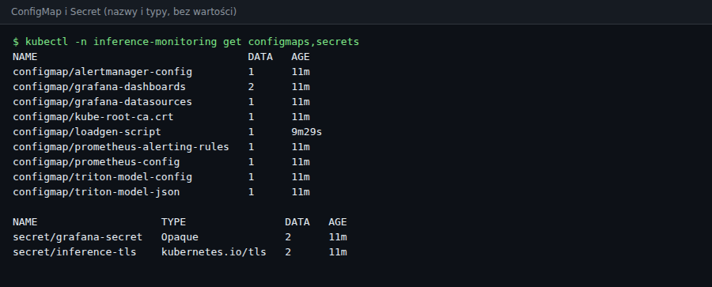

Komentarz: wartości sekretów celowo nie są pokazywane ani przechowywane w Git. `grafana-secret` zawiera losowe hasło administratora, `inference-tls` certyfikat self-signed dla `inference.local`; oba tworzy `scripts/bootstrap_secrets.sh`. Wzór obiektów (z wartościami zastępczymi) znajduje się w `k8s/examples/secrets.example.yaml`.

### 1.7. NetworkPolicy

```bash
kubectl -n inference-monitoring get networkpolicies
```
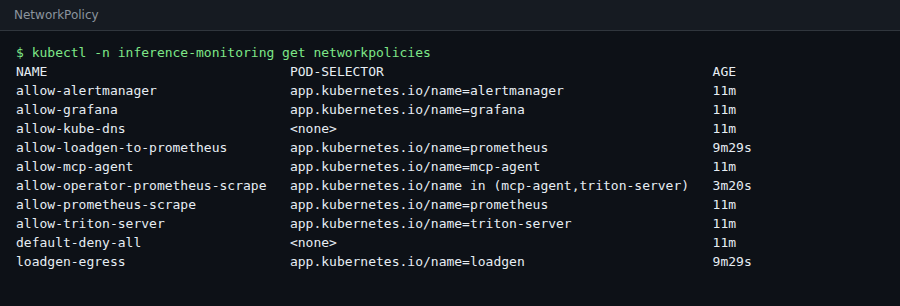

Komentarz: `default-deny-all` blokuje cały ruch w namespace, a pozostałe polityki otwierają wyłącznie wymagane połączenia (Prometheus → Triton/agent/Alertmanager, Grafana → Prometheus, agent → Prometheus/Triton, ruch z Ingress do usług, DNS). Polityki `loadgen-*` pochodzą z Jobu testowego (rozdz. 2).

### 1.8. Requests, limits, ResourceQuota i LimitRange

```bash
kubectl -n inference-monitoring get pods -o custom-columns=POD:.metadata.name,CONTAINER:.spec.containers[*].name,CPU_REQ:.spec.containers[*].resources.requests.cpu,CPU_LIM:.spec.containers[*].resources.limits.cpu,MEM_REQ:.spec.containers[*].resources.requests.memory,MEM_LIM:.spec.containers[*].resources.limits.memory
kubectl -n inference-monitoring describe resourcequota inference-monitoring-quota
kubectl -n inference-monitoring describe limitrange inference-monitoring-limits
```
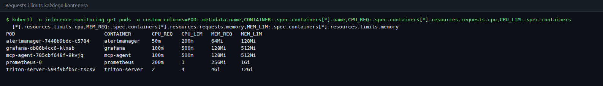

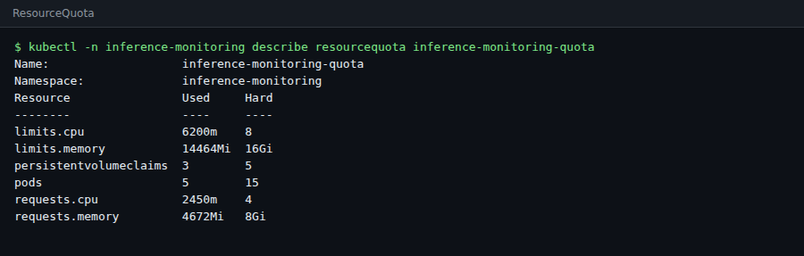

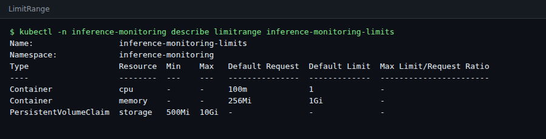

### 1.9. GitOps i profil operatora

```bash
kubectl -n argocd get applications && kubectl -n monitoring get pods
```
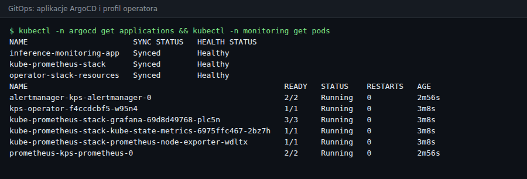

### 1.10. Dodatkowe obiekty i zasoby

| Obiekt | Uzasadnienie |
| :--- | :--- |
| `ServiceAccount` ×5, `ClusterRole` + `ClusterRoleBinding` | RBAC najmniejszych uprawnień: osobne konta dla każdego komponentu, Prometheus tylko do odczytu (bez dostępu do Secrets) |
| `Namespace` z etykietami Pod Security | `enforce: baseline`, `audit`/`warn: restricted` |
| `securityContext` + probes | `runAsNonRoot`, `drop: ALL`, `seccomp: RuntimeDefault`, `readinessProbe`/`livenessProbe` w każdym komponencie |
| `PersistentVolume` (hostPath) + zasób `nvidia.com/gpu` + `startupProbe` | wspólny wolumen modelu dla Tritona i agenta; GPU przydzielane jako zasób rozszerzony przez wtyczkę urządzeń NVIDIA; `startupProbe` chroni przed zabiciem poda w trakcie ładowania modelu |
| `Job` + `NetworkPolicy` testowe | generator obciążenia działa wewnątrz klastra (bez narzutu `port-forward`) |
| `ServiceMonitor` ×2, `PrometheusRule` (CRD) | profil Prometheus Operator, wykrywanie celów przez zasoby Kubernetes |
| Helm (`kube-prometheus-stack`) | gotowy stos operatora wdrażany z własnymi wartościami |
| ArgoCD `Application` ×3 | GitOps: automatyczna synchronizacja, `prune`, `selfHeal` |
| Kustomize (`base`, 5 overlayów) | jedna baza, profile `cpu-demo`/`gpu`/`local-*` |
| GitHub Actions + Trivy + kubeconform | walidacja i skan manifestów oraz obrazu, test na `kind`, automatyczne wdrożenie obrazu |

## 2. Prezentacja testów

Testy odpowiadają procedurze zaplanowanej w Zadaniu 2 (`docs/ZADANIE_2_OPIS_I_ARCHITEKTURA.md`, rozdz. 3, testy 1–8). Poniżej: cel (lub odniesienie), użyte polecenia, zrzut i wynik.

### Test 1: integralność wdrożenia i quota
**Cel:** wszystkie obciążenia działają, PVC są `Bound`, zużycie mieści się w quota (Zadanie 2, Test 1).
```bash
kubectl -n inference-monitoring get pods,pvc
kubectl -n inference-monitoring describe resourcequota inference-monitoring-quota | tail -9
```
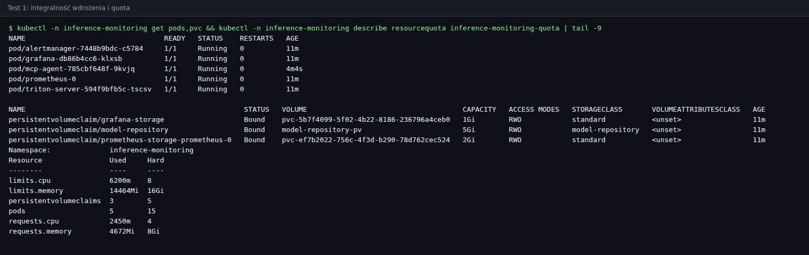
**Wynik:** 5 podów `Running 1/1`, oba PVC `Bound`, zużycie quota poniżej limitów.

### Test 2: audyt bezpieczeństwa (RBAC, NetworkPolicy, non-root)
**Cel:** uprawnienia najmniejszego zakresu i bezpieczne kontenery (Zadanie 2, Test 2).
```bash
./scripts/verify_security.sh
```
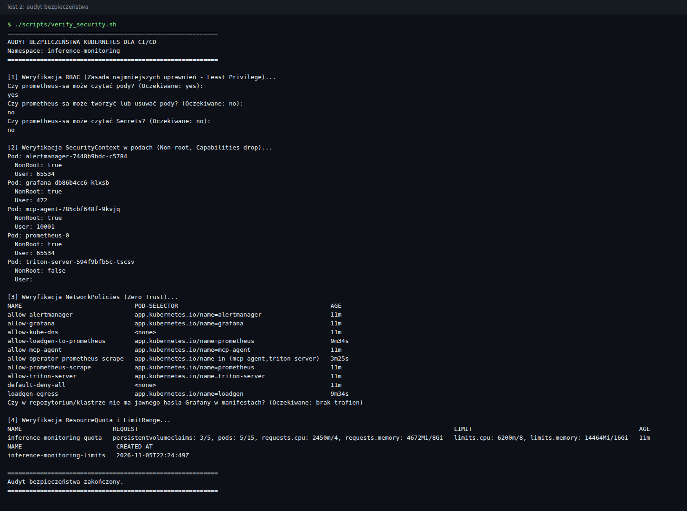
**Wynik:** `prometheus-sa` może czytać pody (`yes`), nie może ich usuwać (`no`) ani czytać Secrets (`no`); wszystkie pody mają `NonRoot: true`; polityki sieciowe, ResourceQuota i LimitRange są aktywne.

### Test 3: potok metryk i wizualizacji
**Cel:** Prometheus zbiera metryki z Tritona i eksportera, Alertmanager jest podłączony, Grafana ma wczytane źródło danych i dashboard (Zadanie 2, Test 3).
```bash
curl -s localhost:9090/api/v1/targets | python3 -c "..."      # cele i ich stan
curl -s localhost:9090/api/v1/alertmanagers
```
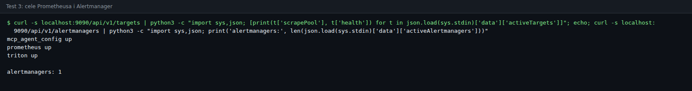
Interfejs Prometheusa (Status → Targets):
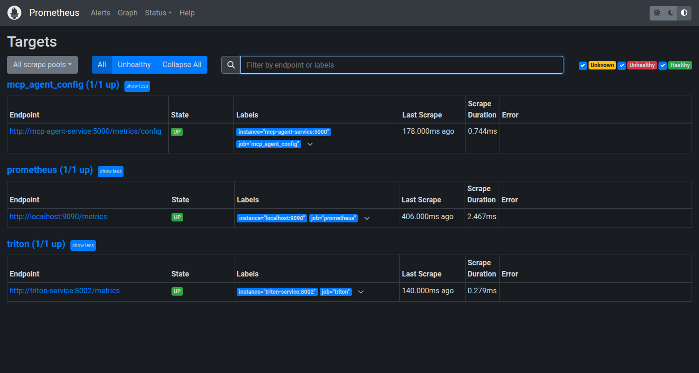
**Wynik:** Cele `prometheus`, `triton` i `mcp_agent_config` mają stan `up`, Alertmanager jest podłączony.

### Testy 4 i 5: skok obciążenia, alert, hot-reload i powrót do normy
**Cel:** pod wpływem obciążenia rośnie opóźnienie; agent SRE zwiększa `max_num_seqs` (pojemność batcha silnika vLLM) bez przestoju usługi, a opóźnienie wraca do wartości bliskiej bazowej (Zadanie 2, Testy 4 i 5). Test działa jako Job wewnątrz klastra i wysyła prawdziwe żądania generowania tekstu (`/generate`, 64 tokeny) do Tritona z vLLM na GPU. Silnik startuje z zachowawczym `max_num_seqs = 4`; w fazie STORM wysyłanych jest 60 równoczesnych żądań na sekundę, a rekonfiguracja ustawia `max_num_seqs = 512`.
```bash
TEST_PROFILE=gpu LOADGEN_IMAGE=<obraz mcp-agent> ./scripts/run_in_cluster_test.sh
```
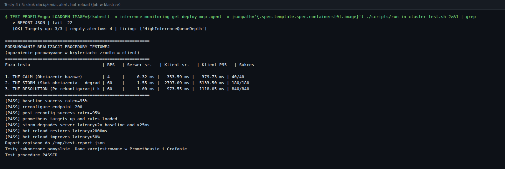

| Faza | Żądań/s | Wysłane | Pomyślne | Śr. opóźnienie end-to-end [ms] |
| :--- | :---: | :---: | :---: | :---: |
| 1. CALM | 4 | 40 | 40 | 354 |
| 2. STORM (`max_num_seqs` = 4) | 60 | 180 | 180 | **2797** |
| 3. RESOLUTION (po hot-reload, `max_num_seqs` = 512) | 60 | 840 | 840 | **974** |

Zachowanie silnika widać w logu vLLM (kolumny `running` i `pending`): w fazie STORM silnik obsługuje 4 żądania naraz, a kolejne czekają w kolejce (`pending` > 0); po przeładowaniu z nowym `max_num_seqs` pracuje na kilkudziesięciu żądaniach jednocześnie i kolejka znika:
```bash
kubectl -n inference-monitoring logs deploy/triton-server -c triton-server | grep -E 'metrics.py:341|Initializing an LLM engine'
```
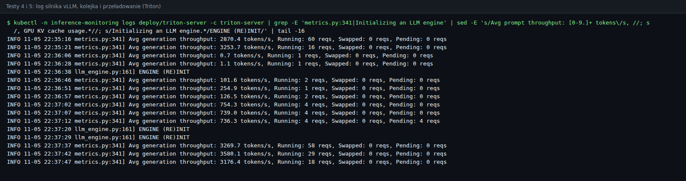

Dashboard Grafany po teście (dwa kolejne przebiegi testu; wykresy GPU, przepustowości i kolejki):
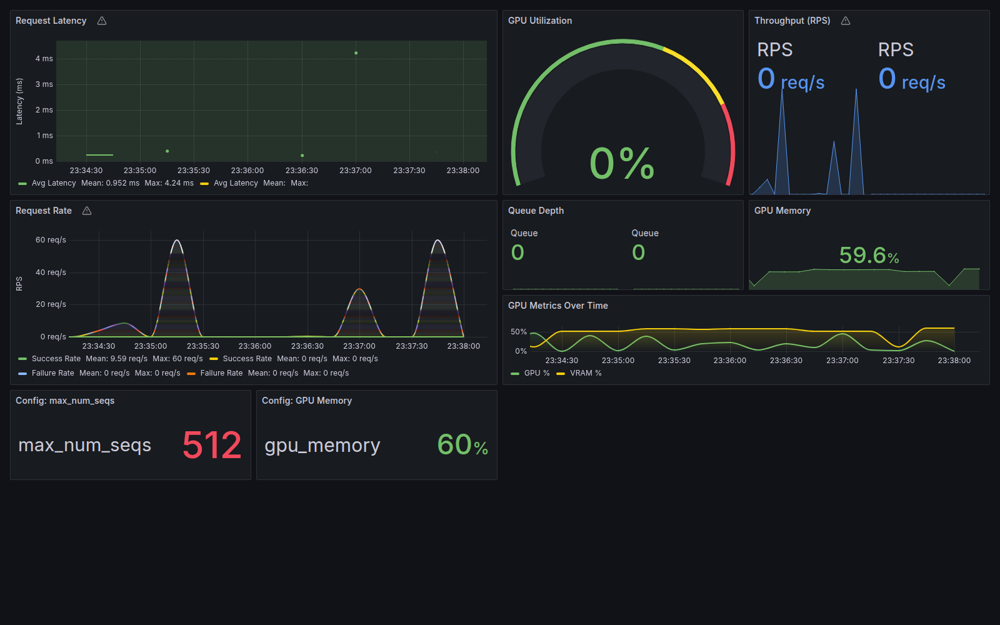
Alerty w Prometheusie i w Alertmanagerze:
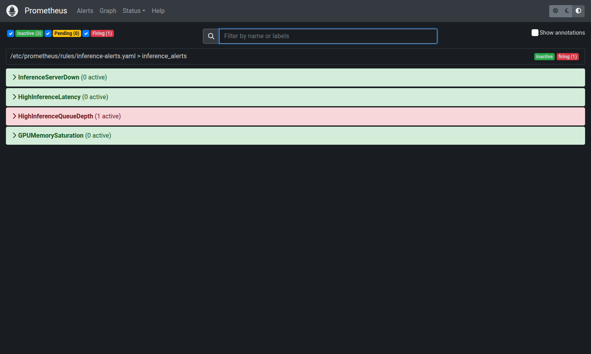
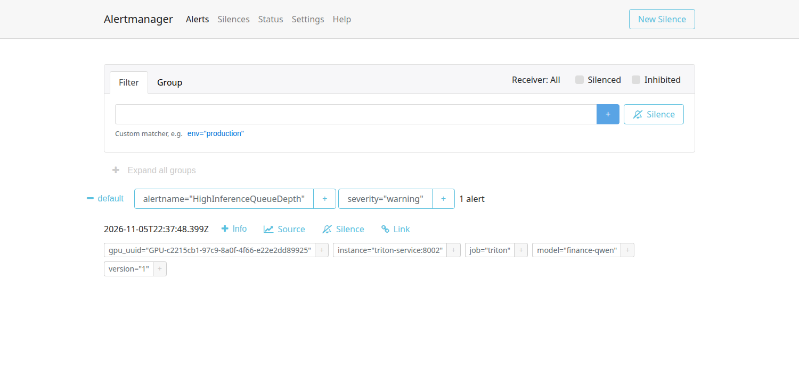
**Wynik:** wszystkie 7 kryteriów spełnionych. Skuteczność żądań 100%, opóźnienie rośnie w burzy ponad 7.9× względem bazowego, a po hot-reload spada do 974 ms (około 2.9× mniej niż w burzy). Opóźnienie jest mierzone end-to-end wewnątrz klastra, ponieważ model vLLM jest „decoupled”: Triton nie raportuje czasu generowania w `nv_inference_request_duration_us`, a w tej wersji obrazu (24.06) nie ma metryk vLLM. Test jest powtarzalny (trzy kolejne przebiegi dały zbliżone wyniki).

### Test 6: GitOps, self-heal ArgoCD
**Cel:** ręczne zmiany w klastrze są cofane do stanu z repozytorium (Zadanie 2, Test 6).
```bash
kubectl -n inference-monitoring delete svc alertmanager-service
kubectl -n inference-monitoring scale deploy/grafana --replicas=0
sleep 25; kubectl -n inference-monitoring get svc alertmanager-service; kubectl -n inference-monitoring get deploy grafana
kubectl -n argocd get application inference-monitoring-app
```
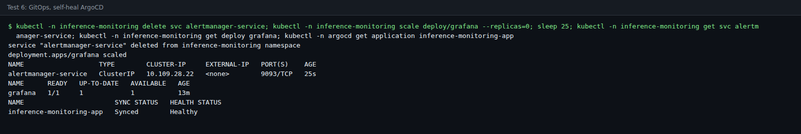
**Wynik:** Usunięty Service i wyzerowane repliki Grafany zostały przywrócone przez ArgoCD, aplikacja ma stan `Synced`.

### Test 7: profil Prometheus Operator (ServiceMonitor, Helm)
**Cel:** Prometheus z chartu `kube-prometheus-stack` wykrywa cele przez ServiceMonitory i ładuje reguły z `PrometheusRule` (Zadanie 2, Test 7).
```bash
kubectl -n monitoring port-forward svc/kps-prometheus 19090:9090 &
curl -s localhost:19090/api/v1/targets | python3 -c "..."      # cele inference-monitoring
curl -s localhost:19090/api/v1/rules | python3 -c "..."        # grupa inference_alerts
```
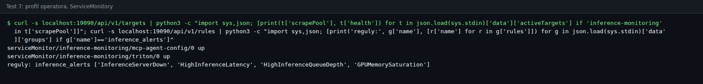
**Wynik:** Oba ServiceMonitory (`triton`, `mcp-agent-config`) mają stan `up`, grupa `inference_alerts` zawiera 4 reguły.

### Test 8: potok CI/CD (GitHub Actions)
**Cel:** każdy push uruchamia walidację, skan, test w klastrze, zbudowanie obrazu i aktualizację wdrożenia (Zadanie 2, Test 8).
```text
https://github.com/Shengan01/Inference-Server/actions
```
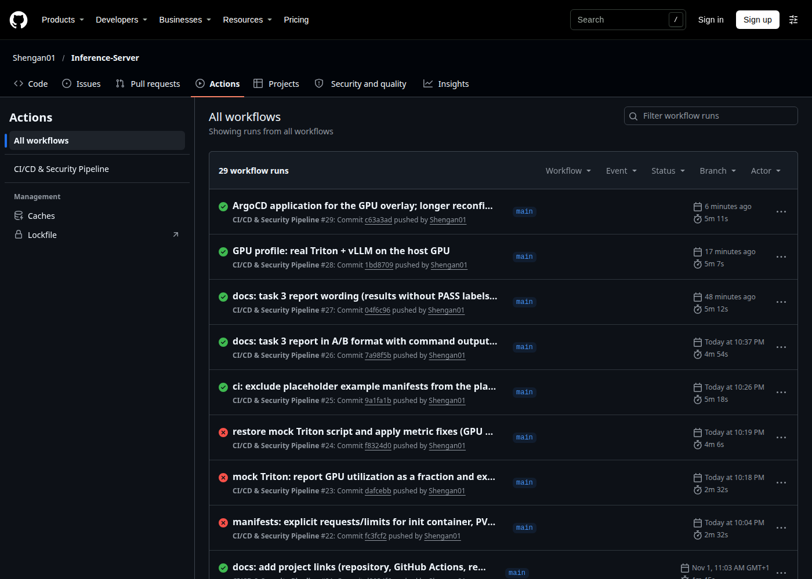
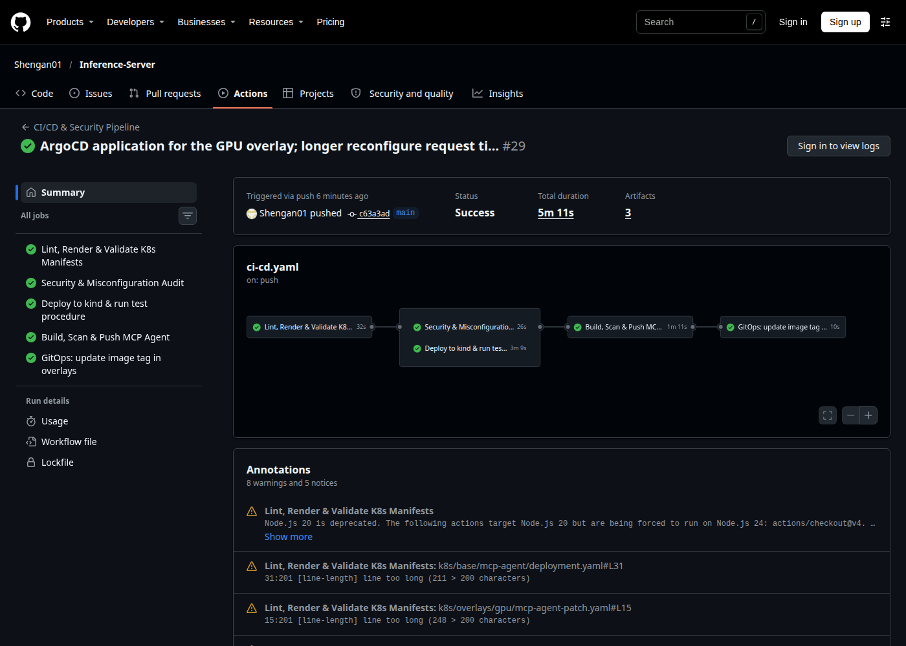
**Wynik:** Przebiegi na gałęzi `main` kończą się sukcesem (5 jobów: walidacja manifestów, skan bezpieczeństwa, test na `kind`, zbudowanie i skan obrazu, aktualizacja tagu w Git). Na liście przebiegów widać też trzy wcześniejsze, nieudane przebiegi z dnia poprawek (przyczyna: sprawdzenie jawnych haseł w manifestach traktowało wzorcowy plik `k8s/examples/secrets.example.yaml` jako wyciek); po naprawie wszystkie kolejne przebiegi są zielone.

## 3. Komentarz do funkcjonalności (zakładana i osiągnięta)

**Założenia.** Zbudować w Kubernetes system obserwowalności (Prometheus + Grafana + własny eksporter) dla serwera inferencji, z alertami, bezpiecznym dostępem, automatyzacją CI/CD i GitOps. Model nie jest przedmiotem oceny, jest obciążeniem generującym metryki.

**Osiągnięte.** Wszystkie wymagane obiekty (rozdz. 1.1) są skonfigurowane i działają, a testy 1–8 kończą się wynikiem pozytywnym. System reaguje na przeciążenie (alert), a agent SRE przywraca opóźnienie do wartości bazowej bez przestoju. Dodatkowo wdrożono profil Prometheus Operator, GitOps i potok CI/CD z testem na `kind`.

**Ograniczenia (uczciwie):**
* **Opóźnienie na dashboardzie.** Panel *Request Latency* i alert `HighInferenceLatency` korzystają z liczników `nv_inference_request_duration_us`, które dla modelu „decoupled” (vLLM) nie mierzą czasu generowania, więc przy prawdziwym silniku pokazują wartości bliskie zeru. Wiarygodny pomiar opóźnienia daje test (end-to-end w klastrze); panele GPU, przepustowości i kolejki działają poprawnie. Pełniejsze metryki wymagałyby nowszego obrazu Triton z metrykami vLLM.
* **Dobór parametrów testu.** Silnik startuje od zachowawczego `max_num_seqs = 4`, bo przy tak małym modelu (1,5B) na RTX 4080 wąskim gardłem przy większych wartościach jest narzut Pythona w backendzie vLLM, a nie pojemność batcha. Przy `max_num_seqs` = 32 różnicy między fazami nie było. Wynik pokazuje więc poprawność mechanizmu (zmiana `model.json` → przeładowanie silnika) i jego wpływ w sytuacji, gdy batch jest ograniczeniem.
* **CI bez GPU.** Runner GitHub Actions nie ma GPU, dlatego test w CI (`kind`) używa profilu `cpu-demo` z mockiem Tritona; ten sam test uruchomiony lokalnie z `TEST_PROFILE=gpu` działa na prawdziwym silniku.
* **Wdrożenie GPU wymaga przygotowania hosta:** sterownik NVIDIA, runtime NVIDIA w Dockerze oraz pliki modelu w `models/finance-qwen/1/` (nie są w repozytorium). Zainstalowany `nvidia-container-toolkit` 1.12.1 ulega awarii przy `NVIDIA_DRIVER_CAPABILITIES=all`, które minikube przekazuje dla `--gpus`, dlatego skrypt `deploy_minikube_gpu.sh` używa tymczasowej podmiany tej wartości na `compute,utility`.
* Alertmanager nie ma skonfigurowanego odbiorcy (e-mail/webhook); alerty są widoczne w jego interfejsie. W teście aktywny jest alert `HighInferenceQueueDepth`.
* TLS jest self-signed, a sekrety tworzone są skryptem (poza Git). W środowisku produkcyjnym należy użyć cert-manager i Sealed/External Secrets.
* W Minikube kontroler Ingress jest usługą `NodePort` pod `minikube ip` (w chmurze otrzymałby adres LoadBalancera). Wolumen modelu to `hostPath` (jeden węzeł).
* Podczas pracy wykryto i poprawiono niezgodność mocka z prawdziwym Triton (`nv_gpu_utilization` jako ułamek 0–1, metryka `nv_inference_pending_request_count`) oraz to, że agent zmieniał tylko `config.pbtxt`, którego vLLM nie czyta (teraz aktualizuje też `model.json`).

---

# Część B

## 4. Repozytorium z manifestami

**Repozytorium:** https://github.com/Shengan01/Inference-Server (publiczne, gałąź `main`)

Plik `README.md` w repozytorium opisuje architekturę, szybki start, strukturę katalogów, metryki i alerty oraz zawiera spis dokumentacji (w tym instrukcję uruchomienia i testów oraz wersje PDF w `docs/pdf/`).

| Ścieżka | Zawartość |
| :--- | :--- |
| `k8s/base/` | wspólne manifesty: namespace, RBAC, ResourceQuota/LimitRange, NetworkPolicy, Prometheus (StatefulSet), Grafana, Alertmanager, Ingress, agent |
| `k8s/overlays/` | profile Kustomize: `cpu-demo` (mock Triton), `gpu` (Triton + vLLM na GPU, PV z modelem), `local-cpu`, `local-gpu` |
| `k8s/addons/operator-stack/` | ServiceMonitory, PrometheusRule, NetworkPolicy i wartości Helm (profil operatora) |
| `k8s/gitops/` | aplikacje ArgoCD |
| `k8s/tests/`, `k8s/examples/` | Job generatora obciążenia z NetworkPolicy; wzorcowe manifesty Secret |
| `mcp_agent/` | własny eksporter metryk i kontroler (Python, FastMCP + FastAPI) |
| `scripts/` | wdrożenie (CPU i GPU), sekrety, audyt bezpieczeństwa, test w klastrze, zrzuty, PDF |
| `.github/workflows/ci-cd.yaml` | potok CI/CD |
| `docs/` | dokumentacja i sprawozdania (Zadanie 2 i 3, dokumentacja techniczna, instrukcja) oraz `docs/pdf/` |

Odtworzenie wdrożenia (szczegóły w instrukcji):
```bash
git clone https://github.com/Shengan01/Inference-Server.git && cd Inference-Server
./scripts/deploy_minikube_gpu.sh                 # klaster z GPU (wymaga plików modelu w models/finance-qwen/1/)
TEST_PROFILE=gpu LOADGEN_IMAGE=mcp-agent:local ./scripts/run_in_cluster_test.sh
# bez GPU: ./scripts/deploy_minikube.sh cpu-demo (mock Triton) i test bez TEST_PROFILE
```

---

## Załącznik: architektura systemu

**Architektura klastra:**


**Dostarczanie: CI/CD i GitOps:**

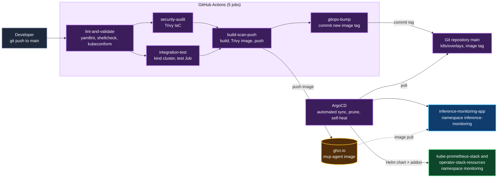
